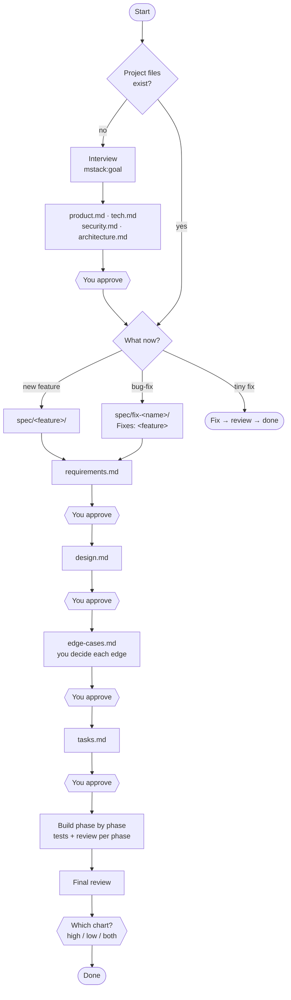

# mstack

An independent planning skill for building production software with AI coding agents.

**The human makes every crucial decision. The agent plans, builds, and shows you what it built.**

```text
Interview  →  product.md · tech.md · security.md · architecture.md
Feature    →  requirements → design → edge cases → tasks → build → charts
Bug-fix    →  requirements → design → edge cases → tasks → build → charts (before/after)
```

mstack isn't an extension of any tool's plan mode. It's its own workflow, and it works the same way in Claude Code, Cursor, Codex and other tools.

- [Install](#install)
- [Skills](#skills)
- [How it works](#how-it-works)
- [The no-guess rule](#the-no-guess-rule)
- [Files mstack creates in your project](#files-mstack-creates-in-your-project)
- [Repository layout](#repository-layout)

---

## Install

mstack has two parts:

| Part | What | Where it goes |
|---|---|---|
| **The pack** | `skills/`, `agents/`, `core/` | a Claude Code plugin, or a folder in your project |
| **`AGENTS.md`** | the rules every agent session reads | your project's root |

mstack writes its own files into `.mstack/` in your project. Commit that folder; mstack ignores `.mstack/.cache/` automatically.

### Claude Code (plugin)

```text
/plugin install mstack --marketplace mahirhacks/mstack
```

Or add the marketplace first, then install:

```text
/plugin marketplace add mahirhacks/mstack
/plugin install mstack@mstack
```

To try a local checkout without installing:

```bash
claude --plugin-dir /path/to/mstack
```

Then copy `AGENTS.md` into your project root (merge it if you already have one) and run `/mstack:goal`.

### Cursor, Codex, Windsurf, Antigravity and others

These tools read `AGENTS.md` (or their own rules file) every session, so mstack runs from a folder in your project.

**macOS / Linux**

```bash
mkdir -p .agent/mstack
cp -R /path/to/mstack/{skills,agents,core} .agent/mstack/
cp /path/to/mstack/AGENTS.md ./AGENTS.md
```

**Windows (PowerShell)**

```powershell
New-Item -ItemType Directory -Force .agent\mstack | Out-Null
Copy-Item -Recurse -Force C:\path\to\mstack\skills, C:\path\to\mstack\agents, C:\path\to\mstack\core .agent\mstack\
Copy-Item C:\path\to\mstack\AGENTS.md .\AGENTS.md
```

If your tool uses a different rules file (`.windsurfrules`, `.cursor/rules`…), paste the contents of `AGENTS.md` into it. Then say **"mstack goal"** to start, or **"mstack feature: <what>"** if your project files already exist.

If your tool has no subagents, mstack runs each role (writer, reviewer…) one after another in the same session. The reviewer passes stay read-only.

### Check that it works

Run `/mstack:status` in Claude Code, or say "mstack status" elsewhere. A new project should report "Project files: missing" and suggest `mstack goal`.

### Upgrading from `mvp-spec-driven-delivery`

- Remove the old pack (`.agent/mvp-spec-driven-delivery/`, `.cursor/skills/mvp-spec-driven-delivery/`, or the old plugin) and replace `AGENTS.md`.
- Existing `.agent/specs/` folders stay as history. New work goes in `.mstack/`.
- To create the 4 project files from an existing codebase, run `/mstack:product` ("mstack product").

---

## Skills

| Skill | Does |
|---|---|
| `/mstack:goal` | Interviews you until every crucial fact is answered, then hands over to `product` |
| `/mstack:product` | Writes or refreshes the 4 project files, including from an existing codebase |
| `/mstack:feature` | Creates `spec/<feature>/` and runs requirements → design → edge cases → tasks → phased build → charts |
| `/mstack:bug-fix` | Creates `spec/fix-<name>/` for a fix or change to a built feature: same steps, with root cause and before/after charts |
| `/mstack:visualhigh` | High-level flowchart (journey with lanes) of what was built |
| `/mstack:visuallow` | Low-level flowchart traced from the code, every box → `file:symbol` |
| `/mstack:mode` | Runs the whole flow, and resumes where it stopped |
| `/mstack:status` | Where everything stands, and what's next |

In Cursor, Codex and other tools, invoke them by phrase ("mstack feature: add reminders"). Requirements, design, edge cases and tasks are **steps inside** `feature` and `bug-fix`, not separate skills. Saying "approved" moves the flow to the next step.

---

## How it works

### Three flows

There's nothing else: no "feature update" and no "extend". A change to an existing feature is either a **new feature** or a **bug-fix**, and a big change to an existing feature is a bug-fix. A tiny fix (typo, one-liner, config value) skips the flows: the agent makes it, a reviewer checks it, done.



A separate, read-only reviewer checks every document **before** you see it. If the review fails, the writer fixes it (at most 3 times) and the document is reviewed again.

### Each step

- **Interview** ([core/interview.md](core/interview.md))
  - The agent reads the repo first.
  - It then asks rounds of at most 5 questions until every crucial fact for the 4 files is answered: users, journey, scope, stack, scale, data, roles, compliance and so on.
  - Vague answers ("fast", "soon") get a follow-up, trigger words such as "payments" or "patients" open new questions, and contradictions get asked about.
  - It ends with a playback of everything, which you confirm before any file is written.
- **Requirements:** testable requirements (`REQ-001`, "WHEN … THE SYSTEM SHALL …"). The agent asks about anything crucial it doesn't know (who can do it, limits, what the user sees) before writing.
- **Design:** how to build it in this repo: components, data, API, errors, security, tests, rollout. Crucial technical choices, such as a new library, a storage choice or a public API shape, are asked, not chosen. The design also lists what the feature changes in the 4 project files.
- **Edge cases** ([core/edge-cases.md](core/edge-cases.md))
  - The agent walks every step of the design against a fixed checklist (bad input, races, failures, permissions, time, abuse…) and ranks what can go wrong S1–S4.
  - **You decide how each one is handled.** Serious edges are asked one by one as scenarios with options. Smaller ones are grouped, or put in an approval table.
  - Shared rules ("what happens when any outside service is down") are asked once and reused.
- **Tasks:**
  - Phases → sub-phases → tasks. Each task has its objective, files, criteria, test and dependencies, and each sub-phase and phase has its own test.
  - Every requirement and every edge maps to a task.
  - If the feature changed the project's shape, stack or security, a final task updates the 4 project files.
- **Build:** one phase at a time. Each phase runs its tasks, its sub-phase tests and its phase test, then gets a read-only review. A final independent review covers everything at the end.
- **Charts** ([core/charts.md](core/charts.md))
  - After the final review, the agent asks which chart you want.
  - **High-level** is the user journey in lanes (user / server / data / outside services).
  - **Low-level** is traced from the real code, with every box pointing to a file and function.
  - For a bug-fix you get the previous chart with the change in a red box, then the same chart with that area expanded.
  - When nothing can render Mermaid, the agent opens an HTML viewer.

### Feature vs bug-fix

Both use the same files and steps. A bug-fix differs in three ways:

1. Its folder is `spec/fix-<name>/`.
2. Its `requirements.md` starts with `Fixes: <feature>` and has a **Bug** section: what's wrong, how to reproduce it, what should happen, the root cause (with evidence from the code), and what must not change.
3. Its charts show **before and after** ([core/charts.md](core/charts.md) §7).

A finished feature folder is never edited again. Later changes live in their bug-fix folders.

### Approval modes

By default the agent **waits for your approval after every document**. You can loosen that:

| Mode | Stops for you at |
|---|---|
| **Gated** (default) | every document, and after every build phase |
| **Quick Plan** | the project files, then once before building |
| **Pre-authorized** | the project files only; the low-level chart is made automatically and the high-level one is offered |

Modes only change *when the agent pauses*, never *who decides*. A new crucial question, a new dependency, or a destructive action stops the run in every mode.

### Roles

| Role | Does | Can edit? |
|---|---|---|
| Main agent | asks you every question, runs the flow, shows you each document | — |
| Writer | drafts one document | that document only |
| Edge analyst | finds edge cases and prepares options; it never chooses them | edge-cases.md only |
| Worker | builds tasks | code |
| Reviewers | check documents, code, charts and guesses | **no**, read-only |
| Chart maker | draws the charts from the code | visuals only |

Nobody approves their own work. The main agent asks all the questions, because helper agents can't talk to you. Strong models write plans and review; cheaper models may do the building ([core/roles.md](core/roles.md)).

---

## The no-guess rule

This is the core rule of mstack ([core/decision-policy.md](core/decision-policy.md)):

- **Crucial decisions are always yours.** A decision is crucial if any of these apply:
  - a user would notice it;
  - it's hard to undo;
  - it touches security, privacy, money or legal;
  - it commits to a vendor or a cost;
  - it changes the project files.

  When the agent is unsure, it treats the decision as crucial.
- **Minor decisions are the agent's:** internal names, file layout, helper functions. Each one is listed so you can see it.
- **Every fact is tagged** with where it came from:
  - you;
  - the repo (confirmed by you);
  - a choice you delegated ("you decide", then confirmed);
  - a minor agent decision.

  Each document ends with a Decision record.
- **Every reviewer checks for guesses.** A crucial claim without a proper source fails the review.

---

## Files mstack creates in your project

```text
.mstack/
├── product.md          # why and what: users, problem, journey, goals, scope
├── tech.md             # built with what, and how to build / test / run / deploy
├── security.md         # threats, roles and permissions, data, compliance
├── architecture.md     # how it's shaped: components, data flow, failure policies
├── state.yaml          # where each flow is, for resuming
└── spec/
    ├── booking/                      # a feature
    │   ├── requirements.md
    │   ├── design.md
    │   ├── edge-cases.md
    │   ├── tasks.md
    │   └── visuals/  high.md · low.md
    └── fix-reminder-timezone/        # a bug-fix (Fixes: booking)
        ├── requirements.md · design.md · edge-cases.md · tasks.md
        └── visuals/  low.md (after) · low.diff.md (before in a red box + after, expanded)
```

The agent names feature and bug-fix folders itself. See [examples/booking/](examples/booking/README.md) for a complete worked example.

---

## Repository layout

| Path | Purpose |
|---|---|
| `.claude-plugin/` | Claude Code plugin and marketplace manifests |
| `skills/` | the 8 skills (`SKILL.md` each) |
| `agents/` | subagents: spec-writer, edge-analyst, task-worker, chart-maker, plus read-only spec-reviewer, task-reviewer, chart-reviewer |
| `core/` | canonical rules: [workflow](core/workflow.md), [decision policy](core/decision-policy.md), [interview](core/interview.md), [edge cases](core/edge-cases.md), [charts](core/charts.md), [roles](core/roles.md), [verification](core/verification.md) |
| `core/templates/` | formats for every document, plus the chart viewer |
| `examples/booking/` | worked example: project files, one feature, one bug-fix with a red-box diff |
| `AGENTS.md` | rules file to copy into your project |
| `CHANGELOG.md` | release history |

The repo root is the plugin itself. Skills reach the shared rules through relative paths (`../../core/…`), so the same files work as a Claude Code plugin and as a copy in `.agent/mstack/`. When this README and a `core/` file disagree, the `core/` file wins.
