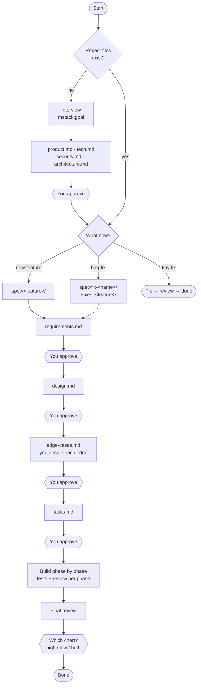

# mstack — Architecture

- Status: Implemented in v2.0.0
- Supersedes: `mvp-spec-driven-delivery` v1.0.0
- Last updated: 2026-10-12
- Canonical rules (these win over this overview):
  - [core/workflow.md](core/workflow.md)
  - [core/decision-policy.md](core/decision-policy.md): the no-guess rule
  - [core/interview.md](core/interview.md)
  - [core/edge-cases.md](core/edge-cases.md)
  - [core/charts.md](core/charts.md)
  - [core/roles.md](core/roles.md)
  - [core/verification.md](core/verification.md)

## 1. What mstack is

mstack is an independent planning skill for building production software with AI agents. It isn't an extension of any tool's plan mode. It's its own workflow and works the same in Claude Code, Cursor, Codex and others. **The human makes every crucial decision**, the agent writes the plan, and nothing gets built before you approve it.

It has three flows:

```text
Interview  →  product.md · tech.md · security.md · architecture.md

Feature    →  spec/<feature>/   requirements → design → edge-cases → tasks → implement → charts

Bug-fix    →  spec/<fix>/       requirements → design → edge-cases → tasks → implement → charts
```

There's nothing else: no "feature update" and no "extend". A change to an existing feature is either a **new feature** or a **bug-fix**. A big change to an existing feature goes in as a bug-fix.

A tiny fix (typo, one-liner, config value) skips the flows: the agent makes it, a reviewer checks it, done.

## 2. Skills

| Skill | Does |
|---|---|
| `mstack:goal` | Runs the interview, then hands over to `product` |
| `mstack:product` | Writes the 4 project files from the interview (and the repo, if there is code) |
| `mstack:feature` | Creates `spec/<feature>/` and runs requirements → design → edge-cases → tasks → build, with your approval after each step |
| `mstack:bug-fix` | Creates `spec/fix-<name>/` and runs the same steps for a fix to an existing feature |
| `mstack:visualhigh` | High-level chart of what was built |
| `mstack:visuallow` | Low-level chart of what was built |
| `mstack:mode` | Runs the whole flow, and resumes where it stopped |
| `mstack:status` | Shows where every feature and bug-fix is, and what's next |

In Claude Code these are invoked as `/mstack:<name>`. In Cursor, Codex and others they're invoked by phrase ("Use mstack goal"). Requirements, design, edge cases and tasks are **steps inside** `feature` and `bug-fix`, not separate skills. Saying "approved" moves the flow to the next step.

## 3. The flows



Every document is checked by a separate, read-only reviewer **before** you see it. If the review fails, the writer fixes it (at most 3 times) and it's reviewed again.

### 3.1 Feature vs bug-fix

Both use the same files and the same steps. A bug-fix differs in only three ways:

1. Its folder is named `spec/fix-<name>/`.
2. Its `requirements.md` starts with `Fixes: <feature>` and has a **Bug** section: what's wrong, how to reproduce it, what should happen, the root cause (with evidence from the code), and what must not change.
3. Its charts show **before and after**: the feature's previous chart with the changed area in a red box, then the same chart with that area expanded (see [charts.md](core/charts.md) §7).

A finished feature folder is never edited again. Later changes live in their bug-fix folders.

### 3.2 Approval modes

By default the agent **waits for your approval after every document**, as in the flow above. You can loosen that:

| Mode | Stops for you at |
|---|---|
| **Gated** (default) | every document, and after every build phase |
| **Quick Plan** | the project files, then once before building (tasks) |
| **Pre-authorized** | the project files only; the low-level chart is made automatically and the high-level one is offered |

Modes only change *when the agent pauses*, never *who decides*. A new crucial question stops the run in every mode ([decision-policy.md](core/decision-policy.md)). New dependencies and destructive actions always stop it too.

## 4. Files in the project

```text
.mstack/
├── product.md          # why and what: users, problem, journey, goals, scope
├── tech.md             # built with what, and how to build / test / run / deploy
├── security.md         # threats, roles and permissions, data, compliance
├── architecture.md     # how it's shaped: components, data flow, failure policies
├── state.yaml          # where each flow is (for resuming)
└── spec/
    ├── booking/                      # a feature
    │   ├── requirements.md
    │   ├── design.md
    │   ├── edge-cases.md
    │   ├── tasks.md
    │   └── visuals/
    │       ├── high.md
    │       └── low.md
    └── fix-double-booking/           # a bug-fix (Fixes: booking)
        ├── requirements.md
        ├── design.md
        ├── edge-cases.md
        ├── tasks.md
        └── visuals/
            ├── low.md                # the chart after this fix
            └── low.diff.md           # before (red box) + after (expanded)
```

The agent names feature and bug-fix folders itself.

`state.yaml` holds only what's needed to resume:

```yaml
mode: gated
features:
  booking:            { status: done }
  fix-double-booking: { status: build, fixes: booking, phase: 2 }
charts:               # newest chart per feature: the "before" for its next bug-fix
  booking: { high: spec/booking/visuals/high.md, low: spec/fix-double-booking/visuals/low.md }
```

## 5. Each step in one paragraph

**Interview** ([interview.md](core/interview.md)). The agent first reads the repo, then asks rounds of at most 5 questions until every crucial fact for the 4 files is answered: users, journey, scope, stack, scale, data, roles, compliance and so on. Vague answers ("fast", "soon") get a follow-up, and contradictions get asked about. It ends with a playback of everything, which you confirm before any file is written.

**Requirements.** Testable requirements (`REQ-001`, "WHEN … THE SYSTEM SHALL …"). The agent asks about anything crucial it doesn't know (who can do it, limits, what the user sees) before writing.

**Design.** How to build it in this repo: components, data, API, errors, security, tests, rollout. Crucial technical choices, such as a new library, a storage choice or a public API shape, are asked, not chosen. It also lists what the feature changes in the 4 project files.

**Edge cases** ([edge-cases.md](core/edge-cases.md)). The agent walks every step of the design against a fixed checklist (bad input, races, failures, permissions, time, abuse…) and lists what can go wrong, ranked S1–S4. **You decide how each one is handled**: serious ones one by one as scenarios with options, smaller ones grouped or in an approval table. Shared rules ("what happens when any outside service is down") are asked once and reused.

**Tasks.** Phases → sub-phases → tasks. Each task has its objective, files, criteria, test and dependencies. Each sub-phase and phase has its own test. Every requirement and every edge maps to a task. If the feature changed the project's shape, stack or security, a final task updates the 4 project files.

**Build.** One phase at a time. Each phase runs its tasks, the sub-phase tests and the phase test, then gets a read-only review. In Gated mode it stops after each phase. A final independent review covers everything at the end.

**Charts** ([charts.md](core/charts.md)). After the final review the agent asks which chart you want. High-level is the user journey in lanes (user / server / data / outside services). Low-level is traced from the real code, with every box pointing to a file and function. For a bug-fix you get the red-box before and after. When nothing can render Mermaid, the agent opens an HTML viewer.

## 6. The no-guess rule

The core rule of mstack ([decision-policy.md](core/decision-policy.md)):

- **Crucial decisions are always yours.** A decision is crucial if a user would notice it, it's hard to undo, it touches security, privacy, money or legal, it commits to a vendor or cost, or it changes the project files. When the agent is unsure, it treats the decision as crucial.
- **Minor decisions are the agent's**, such as internal names, file layout and helper functions. Each one is listed so you can see it.
- **Every fact is tagged** with where it came from: you, the repo (confirmed by you), a choice you delegated ("you decide", then confirmed), or a minor agent decision. Each document ends with a Decision record.
- **Every reviewer checks for guesses.** A crucial claim without a proper source fails the review.

## 7. Roles

| Role | Does | Can edit? |
|---|---|---|
| Main agent | asks you every question, runs the flow, shows you each document | — |
| Writer | drafts one document | the document only |
| Edge analyst | finds edge cases and prepares options (doesn't choose them) | edge-cases.md only |
| Worker | builds tasks | code |
| Reviewer | checks documents, code, charts and guesses | **no**, read-only |
| Chart maker | draws the charts from the code | visuals only |

Nobody approves their own work. Questions are always asked by the main agent, because helper agents can't talk to you. Strong models write plans and review. Cheaper models may do the building.

## 8. This repo

```text
.claude-plugin/          plugin.json + marketplace.json (name "mstack", v2.0.0)
skills/<name>/SKILL.md   goal · product · feature · bug-fix · visualhigh · visuallow · mode · status
agents/                  spec-writer · edge-analyst · task-worker · chart-maker
                         spec-reviewer · task-reviewer · chart-reviewer (read-only)
core/                    canonical rules: workflow · decision-policy · interview · edge-cases ·
                         charts · roles · verification
core/templates/          product · tech · security · architecture · requirements · design ·
                         edge-cases · tasks · chart · chart-viewer.html · review
examples/booking/        worked example: project files, one feature, one bug-fix with a red-box diff
AGENTS.md                rules file copied into target projects
INSTALL.md · README.md
architecture.md          this file
```

The repo root is the plugin itself. The old duplicated `skill/` and `plugin/` folders, the sync scripts and the `/quick-plan`-style commands are gone. Skills reach the shared rules through relative paths (`../../core/…`), so the same files work as a Claude Code plugin and as a copy in `.agent/mstack/`.

## 9. Decisions so far

| | Decision |
|---|---|
| 1 | Name: **mstack**, skills invoked as `/mstack:<name>` |
| 2 | Three flows only: interview, feature, bug-fix (+ a tiny-fix shortcut). No feature-update or extend concept. |
| 3 | The interview creates `product.md`, `tech.md`, `security.md`, `architecture.md`. No separate goal file. |
| 4 | Feature and bug-fix both run requirements → design → edge-cases → tasks → implement, with your approval after each |
| 5 | A big change to an existing feature is a bug-fix; finished feature folders are never edited |
| 6 | Edge cases come after design, live in the feature folder, and you decide each one (format scaled by severity) |
| 7 | Tasks = phases → sub-phases → tasks, with tests at every level; build runs phase by phase; no splitting of big features |
| 8 | Charts: Mermaid in Markdown; the agent asks which chart; Pre-authorized makes low-level automatically |
| 9 | High-level chart = journey with lanes; bug-fix charts show the red-box before and after |
| 10 | HTML viewer when nothing renders Mermaid |
| 11 | No-guess rule; "you decide" allowed with confirmation (never blanket for security, privacy, money, legal) |
| 12 | mstack is an independent planning skill, not a plan-mode extension. Files under `.mstack/`; Claude Code plugin + copy-install for other tools. |
| 13 | Default mode: Gated |
| 14 | Charts are flowcharts only, at both levels |
| 15 | No `production` / `mvp` setting. mstack always plans production-grade, and you can say "keep it lean" for a feature, which the agent records as your decision in that feature's requirements. |
| 16 | Skills: goal, product, feature, bug-fix, visualhigh, visuallow, mode, status. Requirements, design, edge and tasks are steps inside feature and bug-fix, not their own skills. |

## 10. Open

Nothing open at the architecture level. Next: write the templates and turn the design docs into the skill files.
