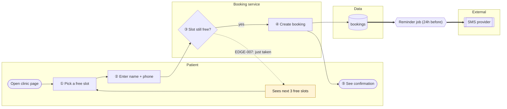
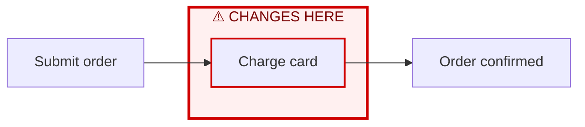
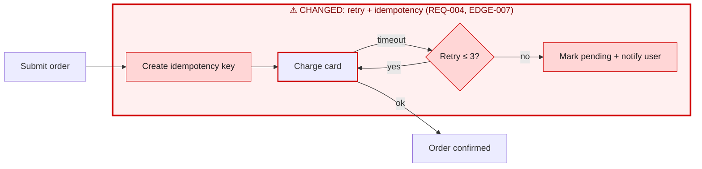

# Charts

The canonical rules for `mstack:visualhigh` and `mstack:visuallow`. Builds on `decision-policy.md` and `edge-cases.md`. The file formats are in `templates/chart.md`, and the viewer is `templates/chart-viewer.html`.

## 1. Purpose

After the final review passes, mstack shows the user **what was actually built**: a picture traced from the code and the approved spec, not drawn from the plan. When an existing feature changes, it shows **where** the change happened (Chart A, red box) and **how** it changed (Chart B, the red area expanded).

Charts follow the no-guess rule too. A node or connection the agent can't trace to code or to an approved artifact isn't drawn as if it were known. It's drawn as **unverified** and listed (§5.3).

## 2. Which chart?

Right after the final review passes:

```text
Build complete — booking (Phases 1–3 ✅, final review PASS)

Which chart do you want?
  (a) High-level — how it works for the people using it (~10–20 boxes)
  (b) Low-level — functions, files, data and error branches (for engineers)
  (c) Both (Recommended for a new feature)
  (d) Neither for now
```

- **Pre-authorized mode:** the low-level chart is generated automatically, and the final report ends with "High-level chart available. Want it?"
- The recommendation adapts: (c) for a new feature, (b) for a bug-fix.
- Asking for a chart later is always possible (`/mstack:visualhigh`), and it's drawn from the code as it is then.

## 3. The two levels

| | High-level | Low-level |
|---|---|---|
| Question it answers | "What happens, step by step, for the people involved?" | "Which code runs, in what order, touching which data?" |
| Layout | **journey with lanes**: one lane per actor or system (User, App, Server, External) | **call flow per entry point**, grouped into one box per module |
| Nodes | user actions, screens, system steps, decisions, data stores, external systems, notifications | entry points (route, handler, job), functions, branches, tables, queues, external calls |
| Main path | numbered ①②③ so the walkthrough can reference steps | not numbered; the walkthrough references node IDs |
| Failure paths | only edges with MUST-HANDLE severity S1/S2 | every implemented MUST-HANDLE / SHOULD-HANDLE error branch |
| Traced to | REQ / AC / design section / EDGE | `file:symbol` (+ EDGE for error branches) |
| Size limit | ≤ 20 nodes | ≤ 40 nodes per chart |
| Built from | approved spec + final-review evidence that each step is implemented | the code (call paths, imports, data access), checked against the spec |

## 4. Notation

The same symbol always means the same thing, at both levels and in every project.

### 4.1 Shapes

| Shape | Mermaid | High-level meaning | Low-level meaning |
|---|---|---|---|
| Stadium | `ID([…])` | start / end of the journey | — |
| Rectangle | `ID[…]` | user action or system step | function / method |
| Diamond | `ID{…}` | decision | meaningful branch (`if` / `switch` that changes the path) |
| Cylinder | `ID[(…)]` | data store | database table / collection |
| Subroutine | `ID[[…]]` | external system | external API call |
| Hexagon | `ID{{…}}` | background job | job / worker handler |
| Asymmetric | `ID>…]` | message sent (SMS, email, push) | queue / topic publish |
| Parallelogram | `ID[/…/]` | — | entry point (HTTP route, CLI command, event handler) |

### 4.2 Lines

| Line | Mermaid | Meaning |
|---|---|---|
| Solid | `-->` | normal flow / call |
| Dotted, labelled | `-.->\|EDGE-007\|` | failure / edge-handling path, with its EDGE ID |
| Thick | `==>` | asynchronous hand-off (enqueue, webhook, event) |
| Dotted, `?` label | `-.->\|?\|` | **unverified** connection (§5.3) |

### 4.3 Colours

Colour is reserved for meaning:

| Class | Style | Meaning |
|---|---|---|
| default | theme default | normal |
| `failure` | amber fill | a node that exists to handle a failure |
| `unverified` | grey, dashed border | can't be traced with certainty |
| `changed` (subgraph) | light-red fill, **red 3px border** | diff only: the change zone |
| `added` | red fill | diff only: a new node |
| `modified` | red border | diff only: a changed node |
| `removed` | grey fill, dashed, struck label `~~…~~` | diff only (Chart B): a deleted node |

**Red appears only in diffs.** That way, red always means "this changed", and a user never has to wonder whether red marks an error path.

### 4.4 Node IDs

Stable IDs are what make diffs possible:

| Level | Scheme | Example |
|---|---|---|
| High | `UPPER_SNAKE` actor/domain + action | `PATIENT_PICK_SLOT`, `SMS_REMINDER` |
| Low | `MODULE__SYMBOL` | `SLOT_SERVICE__RESERVE`, `ROUTE__POST_BOOKINGS` |

Rules:

- **An ID never changes while the thing it represents exists.** If `reserve()` is renamed to `holdSlot()`, the ID stays `SLOT_SERVICE__RESERVE` and the node becomes `modified`. The trace table records the new symbol.
- **An ID is never reused** for something else after removal.
- A node moved to another module keeps its ID and appears as `modified` with a "moved" note.

## 5. How a chart is built

### 5.1 High-level

1. Start from the design's component and data-flow diagrams (design.md §components), which already use stable IDs.
2. Lay out lanes from the actors in requirements R1 and the components in `architecture.md`.
3. Draw the primary journey (P5 / R3) as numbered steps.
4. Add decision points from the acceptance criteria.
5. Add failure paths for S1/S2 MUST-HANDLE edges, each labelled with its EDGE ID.
6. **Verify:** each node must be backed by final-review evidence that it's implemented (a passing test, or code the reviewer cited). An approved-but-unbuilt step is a defect, which the final review should already have caught. If it's found here, the chart stops and the issue is reported.

### 5.2 Low-level

1. Find the **entry points** this feature added or touched: routes, handlers, jobs, CLI commands, UI event handlers.
2. For each entry point, trace the call path through the code using symbol search or the call hierarchy, recording every function on the path that's part of this feature or that it calls into meaningfully.
3. Add the data accesses (tables read and written) and external calls.
4. Add error branches that implement MUST-HANDLE / SHOULD-HANDLE edges.
5. Collapse trivial helpers (formatting, logging) unless the user asks for them.
6. **Every node carries a `file:symbol`**, which goes in the trace table (§6.3), not in the label, to keep labels short. The label is `symbol()` plus, optionally, a 2–4 word purpose.

### 5.3 No guessing in charts

Some connections can't be traced with certainty: dynamic dispatch, dependency injection, event buses, reflection, config-driven routing. For these the agent:

- draws the link as `-.->|?|` with the `unverified` class;
- lists each one under **Unverified links**, with what it tried and what would confirm it ("runtime trace of `OrderCreated` subscribers");
- never draws a guessed connection as a solid line.

The chart-reviewer FAILs a chart that contains a solid link it can't verify in code.

### 5.4 Size and splitting

| Situation | Handling |
|---|---|
| High-level > 20 nodes | split by journey (e.g. "Patient booking", "Staff calendar"), with an **overview chart** of the journeys as single nodes |
| Low-level > 40 nodes | split **by entry point**: one chart per route, job or handler, plus an **index chart** (entry points → modules) |
| One entry point alone > 40 | split by module boundary, with "continues in chart X" connector nodes |

In a diff, only the affected sub-charts are shown, plus the overview or index with the affected sub-chart red-boxed.

## 6. Presenting a chart (new feature)

### 6.1 Sequence

What the user sees, in order:

1. **Header:** what was built, at which level, from which spec folder.
2. **Reading key:** a single compact line explaining the shapes and lines used in *this* chart only.
3. **The chart.**
4. **Walkthrough:** 3–8 numbered lines narrating the main path. High-level uses ①②③; low-level uses node IDs.
5. **Failure paths:** one line per drawn EDGE path ("If the slot was just taken → EDGE-007 → shows next 3 free slots").
6. **Trace table:** collapsed or after the walkthrough. High-level: node → REQ / AC / design. Low-level: node → `file:symbol`.
7. **Unverified links**, if any.
8. **Next actions:** "Ask about any box · see the low-level chart · zoom into a step".

### 6.2 Example: high-level, new feature

> **Booking: high-level** · `spec/booking/` · built 2026-10-15
> Key: rectangle = step · diamond = decision · cylinder = data · `[[ ]]` = external service · dotted = failure path



> **Walkthrough**
> ① The patient picks a free slot on the clinic's page. ② They enter a name and phone number. ③ The server checks the slot is still free (a unique constraint makes this race-safe). ④ The booking is saved. ⑤ The patient sees a confirmation. 24 hours before the appointment, the reminder job sends an SMS.
>
> **Failure paths**
> - EDGE-007: the slot was taken in the meantime → the patient is shown the next 3 free slots.
>
> **Next:** ask about any step · see the low-level chart · zoom into a step

### 6.3 Example: low-level trace table

| Node | `file:symbol` | Traces |
|---|---|---|
| `ROUTE__POST_BOOKINGS` | `app/api/bookings/route.ts:POST` | REQ-002 |
| `SLOT_SERVICE__RESERVE` | `src/booking/slot-service.ts:reserve` | AC-002.1, EDGE-007 |
| `DB__BOOKINGS` | `prisma/schema.prisma:model Booking` | design §4 |

## 7. Presenting a bug-fix: the red-box diff

### 7.1 Sequence

1. **Change summary:** what changed and why, in 1–3 lines, with the REQ / EDGE / bugfix IDs. One sentence on what did **not** change ("the other 14 steps are unchanged").
2. **Chart A — Before: where the change happens.** The latest chart from the `charts` pointer, **copied exactly**, with the change zone wrapped in the red subgraph and modified or removed nodes outlined red.
3. **Chart B — After: the red zone expanded.** The same chart: identical IDs, order and labels for unchanged nodes. Only the inside of the red zone differs, with added nodes red-filled and removed nodes struck through.
4. **Change legend:** node · change type · why · where.
5. **Focus view** (only when the chart has more than 20 nodes): Chart B cropped to the red zone plus one neighbour on each side, so the change is readable without scrolling.
6. **Next actions:** "Ask about any change · see the other level · compare with an older version".

### 7.2 How A and B are made

1. **Load the previous chart exactly as saved.** It comes from the `charts` pointer in `state.yaml`: the newest chart of the fixed feature, which is either in the feature folder or in an earlier bug-fix folder. It's never redrawn from memory.
2. **Work out what changed** from the code diff, the tasks just completed, and the REQ/EDGE IDs they touched. Mark each node and link as `added`, `modified`, `removed` or `unchanged`.
3. **Chart A** is the previous chart, unchanged, with a red box drawn around the area that changes.
4. **Chart B** is the same chart with the same IDs and the unchanged parts identical. Only the inside of the red box is replaced by the new, expanded content.
5. **Legend:** node · change · why · where.
6. **Save:** A + B + legend go to the bug-fix folder's `visuals/<high|low>.diff.md`. Chart B without the red styling goes to `visuals/<high|low>.md`. After the chart-reviewer passes, the `charts` pointer moves to the new clean chart.

If the feature has no previous chart, a fresh chart is drawn, and the agent says "no previous chart, so there's no diff".

### 7.3 Example

Each chart is its own Mermaid block, so both use the same IDs.

**Chart A: Before (change zone in red)**



**Chart B: After (red zone expanded)**



| Node | Change | Why | Where |
|---|---|---|---|
| IDEMP | added | EDGE-007, Task 3.1 | `src/checkout/idempotency.ts:createKey` |
| PAY | modified | REQ-004 | `src/pay/client.ts:charge` |
| RETRY | added | EDGE-007, Task 3.2 | `src/pay/retry.ts:withRetry` |
| PENDING | added | AC-004.2, Task 3.3 | `src/checkout/order.ts:markPending` |


### 7.4 Special cases

| Case | Handling |
|---|---|
| Change spans two distant areas | two red zones in A and B, numbered "Change 1" and "Change 2", each with its own legend block |
| Change affects most of the chart (>50% of nodes) | the agent says so and shows A and B without a zone, plus the legend: "this is a near-rewrite" |
| Change is in a sub-chart | show the index/overview with the sub-chart node red-boxed, then A/B of that sub-chart only |
| Node removed | Chart A: red outline. Chart B: shown once as `removed` (grey, dashed, struck). It disappears from the clean saved chart. |
| Pure bugfix with no structural change (a condition corrected inside one function) | A and B have the same structure. The changed node is `modified`, and the legend states the behavioural change ("now rejects end < start") |
| No previous chart exists | the agent draws a fresh chart and says "no previous chart, so there's no diff" |

## 8. Rendering: how the user actually sees it

The canonical format is Mermaid in Markdown (decided). But **not every place renders Mermaid**, and the Claude Code terminal shows the raw text. So display uses the best renderer available:

| Environment | How the chart is shown |
|---|---|
| Client renders Mermaid in chat (some desktop and web clients) | Mermaid block in chat |
| IDE with a Markdown preview that supports Mermaid (VS Code, Cursor) | open `visuals/<level>.md` (or `.diff.md`) in the preview |
| Rich display tool available (e.g. Claude desktop artifacts or inline visuals) | render through it, with A and B side by side |
| Terminal only (or as the fallback anywhere) | **HTML viewer** (§8.1) |

In **every** environment, the walkthrough, failure paths and legend are also printed as plain text in chat, so a terminal user understands the change even before opening a chart.

### 8.1 HTML viewer

- **One self-contained file per display**, built from `templates/chart-viewer.html` and written to `.mstack/.cache/view-<slug>-<level>.html`. mstack creates `.mstack/.gitignore` containing `.cache/`, so viewers are never committed. The canonical charts stay the `.md` files.
- It loads Mermaid from the pinned CDN version in the template, and has no install step. Opening it needs network access once.
- **Layout:** header and change summary on top; Chart A and Chart B **side by side** (stacked on narrow screens); the legend, walkthrough and trace table below. Charts have zoom buttons and scroll to pan.
- The agent prints the path (and opens it when the platform can open files or a browser), then shows the plain-text walkthrough and legend in chat.
- It's regenerated on every display, so it never goes stale against the `.md`.

## 9. After the chart

| User says | Agent does |
|---|---|
| "Explain `RESERVE`" | explains the node using its trace (code + REQ + EDGE) |
| "Zoom into step ③" | a sub-chart of that node's internals; at high level this is often the matching low-level slice |
| "Show the other level" | generates it (same rules) |
| "Compare with the version before the SMS fix" | draws A/B between those two saved charts (feature folder or earlier bug-fix folders) |
| "This box is wrong" | treated as a possible defect: re-trace from code. If the code is wrong, it's a bugfix. If the chart is wrong, it's corrected and re-reviewed. |

Follow-up views are shown, not saved, unless the user asks to save them. The canonical chart doesn't change.

## 10. Chart-reviewer checks

The read-only `chart-reviewer` FAILs the chart if any of these hold:

- a low-level node's `file:symbol` doesn't exist;
- a solid link isn't backed by a call, import or data access in the code;
- a high-level node has no REQ / AC / design trace, or no implementation evidence;
- a MUST-HANDLE S1/S2 edge has no failure path drawn (high), or an implemented error branch is missing (low);
- the notation is broken: red used outside a diff, or a positional ID (`A`, `B`, `n1`);
- in a diff:
  - an unchanged node differs between A and B (ID, label or connections);
  - a changed node sits outside the red zone;
  - the legend is incomplete;
  - Chart A isn't byte-identical to the pointer's chart apart from the red styling;
- a size limit is exceeded without a split.
