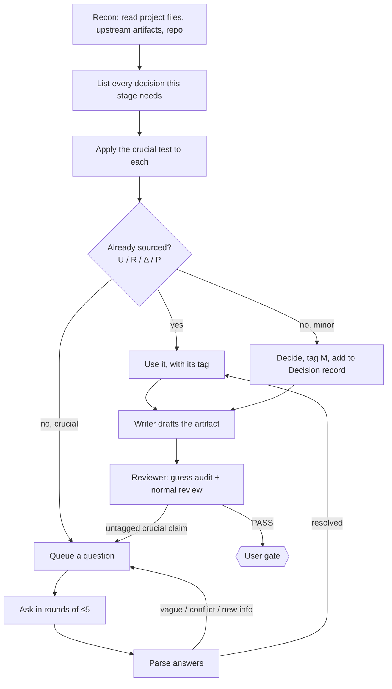

# No-Guess Decision Policy

The canonical rules for who decides what. They apply to every skill, every step and every approval mode.

## 1. The rule

> **The human makes every crucial decision. The agent makes only minor decisions, and it discloses every one it makes. Nothing crucial is ever assumed.**

The approval mode (Gated / Quick Plan / Pre-authorized) controls **when the agent pauses at gates**. It never controls **who decides**. Pre-authorized lets the agent move through gates without stopping, but it doesn't let the agent decide crucial questions. A new crucial unknown always stops the run.

## 2. Where knowledge comes from

Every fact or decision in an mstack artifact carries a source tag:

| Tag | Source | Allowed for crucial items? |
|---|---|---|
| `[U:<ref>]` | **User** answered it (reference to the question, e.g. `[U:I-2.3]`) | yes |
| `[R:<path>]` | **Repository** evidence (file, config, schema), e.g. `[R:docker-compose.yml]` | yes, after the user confirmed the repo facts (§5 of interview.md) |
| `[Δ:<ref>]` | **Delegated**: the user explicitly said "you decide" for this question | yes, and the agent's choice is shown back to the user |
| `[U:EP-<id>]` | **Policy**: resolved by a user-approved policy (e.g. edge policy `EP-02`) | yes |
| `[M]` | **Minor** decision made by the agent | **no**, minor items only |
| `[?]` | **Open**: not known yet | blocks the gate when the item is crucial |

The **assumption** source doesn't exist in mstack. An agent that feels the urge to assume something crucial has found a question.

## 3. Crucial or minor?

Before acting on any decision, the agent applies the **crucial test**. The decision is **crucial** if *any* answer is yes:

1. **Visible:** would a user, customer or operator notice if a different choice were made?
2. **Hard to reverse:** would undoing it take a data migration, a public contract change, or more than about a day of rework?
3. **Protected domain:** does it touch security, privacy, permissions, money, legal or compliance?
4. **Commitment:** does it commit to a vendor, a new dependency, a paid service, or ongoing cost?
5. **Contested:** would two competent engineers reasonably choose differently, *and* would the difference matter to the product?
6. **Project files:** does it contradict, extend or reinterpret a project file?

**When the agent is unsure whether something is crucial, it treats it as crucial.** Being asked one question too many is cheap. A wrong guess built into a design is not.

### 3.1 Examples

| Stage | Crucial: the human decides | Minor: the agent decides and discloses |
|---|---|---|
| Interview | target users, v1 scope, platforms, data collected, compliance, budget, hosting | wording of project-file prose, section order |
| Requirements | behaviour on every user-visible path, validation rules, permission rules, limits, notification content | REQ numbering, grouping of stories |
| Design | storage technology, new dependencies, public API shape, sync vs async, migration strategy, feature flag rollout | internal module names, helper extraction, file placement following `tech.md` conventions |
| Edges | the handling of **every** edge, including "accept the risk" | deduplication and grouping of edges |
| Tasks | phase boundaries when they change what gets delivered first | task granularity, order within a dependency-free set |
| Build | anything the approved spec doesn't cover that passes the crucial test | variable names, private helpers, test file layout, log wording |
| Charts | — | layout direction, node grouping, splitting a chart for readability |

## 4. The clarify loop (used by every stage)

Every writing stage (interview, requirements, design, edge, task) runs the same loop *before* its writer drafts anything final:



The questions are always asked by the **parent agent**, because subagents can't talk to the user. Writer subagents return a list of crucial unknowns instead of guessing, and the parent asks them.

## 5. The Decision record

Every mstack artifact (the 4 project files and every spec file) ends with a **Decision record**, so nothing needs a separate log file:

```markdown
## Decision record

### Human decisions
| ID | Question | Answer | Source | Date |
|---|---|---|---|---|
| I-2.3 | Who books appointments: patients, staff, or both? | Both; staff can book on behalf of patients | user | 2026-10-12 |
| E-07 | Payment provider times out after 15s: what happens? | Keep order pending, retry 3× over 1 min, then email user | user | 2026-10-14 |
| D-03 | Which queue for background jobs? | "You decide" → agent chose BullMQ (Redis already in stack), user confirmed | delegated | 2026-10-14 |

### Agent decisions (minor)
| What | Choice | Why it's minor |
|---|---|---|
| Module name for retry helper | `src/pay/retry.ts` | internal, follows tech.md conventions, trivially renamed |

### Open
| ID | Question | Blocks |
|---|---|---|
| — | none | — |
```

Question IDs are stable and prefixed by stage: `I-` interview, `Q-` requirements, `D-` design, `E-` edge, `T-` tasks, `B-` build.

## 6. Delegation ("you decide")

The user may delegate any question. Delegation is a human decision about *who* decides, so it isn't a guess. The rules:

- The agent states its choice and the reason in one line. For crucial items, it asks for a one-word confirmation ("ok?") before using the choice.
- The choice is tagged `[Δ:<ref>]`, so it stays visible and easy to revisit.
- **Blanket delegation** ("decide everything technical yourself") is accepted only for categories the user names explicitly. It's recorded at the top of the Decision record. Protected domains (security, privacy, money, legal) can't be blanket-delegated. Each one still gets its own confirmation.

## 7. "I don't know"

When the user can't answer:

1. The agent re-asks with concrete options and their consequences, plus a recommendation that states its basis.
2. If the user is still unsure, they can **delegate** (§6) or **park** the question.
3. A parked crucial question is marked `[?]` and blocks the first gate that depends on it. The agent tells the user exactly which later step it blocks.

## 8. Discoveries during the build

When a worker hits something the approved spec doesn't cover:

| Discovery | Action |
|---|---|
| Fails the crucial test | **Stop** in every mode. The worker reports it, the parent asks the user, and the answer is recorded (`B-` ID) in the relevant artifact's Decision record. If it changes requirements or design, the downstream approvals are invalidated. |
| Minor | The worker decides, tags `[M]`, and lists it in the phase report. |

While the build waits for an answer, workers may continue only with tasks that don't depend on the open question.

## 9. Enforcement

Prompting alone won't keep the agent from guessing, so the rule is checked by reviewers:

- **Guess audit.** Every reviewer pass (`spec-reviewer`, `task-reviewer`, `chart-reviewer`) scans the artifact for crucial claims. **FAIL** if any crucial claim:
  - has no tag;
  - is tagged `[M]`;
  - is tagged `[R]` without a user-confirmed repo fact;
  - is still `[?]` at its gate.
- **Playback diff.** At the project-files approval, the reviewer checks that the project files contain no crucial claim absent from the confirmed interview playback.
- **Code audit.** The final reviewer checks for implemented behaviour that passes the crucial test but isn't traceable to an approved artifact or a `B-` decision. That's an undisclosed guess, and the result is FAIL.

## 10. Question standard (shared by all stages)

### 10.1 Anatomy

Every question the agent asks has the same parts:

```text
[Context]   one line: why this matters / what it affects
[Question]  one decision only
[Options]   2–4 concrete options, each with its consequence
            (Recommended) marked, with the basis for the recommendation
[Other]     free text, always available
[Affects]   the file/section the answer lands in
```

When the platform has a structured question tool (`AskUserQuestion`), the options use it. Otherwise they're numbered plain text.

### 10.2 Question types

| Type | Use for | Example |
|---|---|---|
| Choice | discrete options | "Web only, mobile only, or both at launch?" |
| Quantity | numbers that drive design | "How many bookings per day at launch: <100, 100–10k, >10k?" |
| Walkthrough | journeys and flows | "Walk me through the first thing a clinic admin does after signing up." |
| Scenario | behaviour under a specific event (edges) | "A patient double-clicks Book: what should happen?" |
| Boundary | scope | "Is rescheduling in v1 or later?" |
| Priority | trade-offs | "If fast launch and HIPAA-grade audit logging conflict, which wins?" |
| Confirmation | repo facts, playback, delegated choices | "The repo uses Postgres 15 via Prisma. Keep it?" |

### 10.3 Rules

- **One decision per question.** A question with "and" in it usually needs splitting.
- **≤5 questions per round.** Group them by theme, and put the questions that unblock others first.
- **Plain language** matched to the user's stated expertise (interview phase 1). Technical choices for a non-technical user are described by consequence ("cheaper but slower to set up"), never left unasked.
- **Recommendations need a basis** (a repo fact, an earlier answer, a stated constraint). When the agent has no basis, it gives no recommendation.
- **No leading or loaded questions.** "You'll want X, right?" is forbidden.
- **Never ask what is already sourced.** Re-asking a `[U]` answer is a defect. Confirming an `[R]` fact once is required.
- "Anything else?" is allowed only as the **last** question of a phase.
