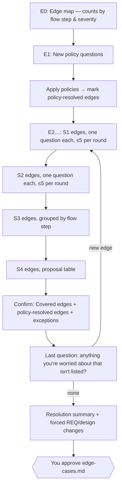

# Edge Cases

The canonical rules for the edge-cases step of `mstack:feature` and `mstack:bug-fix`. Builds on `decision-policy.md` and the probe rules in `interview.md`. The output format is in `templates/edge-cases.md`.

## 1. Purpose

The edge step runs after the design is approved. It has two jobs:

1. **Find:** systematically discover what can go wrong in the designed feature: bad input, failures, races, abuse, logic holes.
2. **Resolve with the human:** get a **user decision for every edge's handling**. The agent proposes options and consequences. The user chooses.

The agent never decides how an edge is handled. It decides only how edges are grouped and worded.

## 2. Inputs

- `spec/<feature>/requirements.md` and `design.md` (approved)
- the four project files, especially `security.md` (threats, roles, data) and `architecture.md` (the **Failure policies** section, §4.1)
- for a bug-fix: the fixed feature's `edge-cases.md` and earlier bug-fix folders, whose root causes are evidence of what has actually broken before
- the repo: existing error handling, retry helpers, validation, rate limiting
- the probe-rule domains triggered in the interview (payments, health, AI…), which tell the agent which categories need extra depth

## 3. Generation: how the agent finds edges

Generation runs in a writer subagent (`edge-analyst`). The thinking is structured so coverage doesn't depend on the agent's imagination.

### 3.1 Step 1: model the design

The analyst first extracts an **edge surface model** from `design.md`. Every later step works on this model:

| Element | Extracted as |
|---|---|
| Flows | each flow as ordered steps (`F1.1 Patient selects slot`, `F1.2 API reserves slot`…) |
| Components | each service, module, job, client |
| Data entities | each entity with its invariants ("a slot has at most one booking") |
| External dependencies | each third-party call, with what it returns and how it fails |
| Trust boundaries | where data crosses from less-trusted to more-trusted (client → API, webhook → API, LLM output → tool call) |
| State machines | each entity with lifecycle states (`booking: pending → confirmed → cancelled`) |
| Actors | every P2/P3 user, plus *attacker*, *admin*, *support*, *system/cron* |

### 3.2 Step 2: the sweep matrix

The analyst walks a **matrix**: each flow step × each taxonomy category. For every cell, it runs that category's **probe questions** against that step:

| Category | Probe questions |
|---|---|
| Input & validation | Missing? Empty? Too long or too large? Wrong type or format? Unicode, emoji, RTL? Injection payload? Boundary values (0, −1, max, max+1)? |
| State & concurrency | Done twice? Two actors at once? Steps out of order? Acting on a stale read? Interrupted halfway? |
| Dependency failure | Slow? Down? Error response? Partial or garbage response? Rate-limited? Succeeds but we never hear back? |
| Data integrity | Duplicate? Referenced record deleted? Schema mismatch with old data? Invariant violated? |
| Auth & permission | Not logged in? Session expires mid-flow? Wrong role? Other tenant's ID in the request? Revoked access with an open session? |
| Logic failures | Impossible state reachable? Rounding or currency? Off-by-one? Sorting or pagination drift? Contradicting rules? |
| Time | Timezone of user vs server vs business? DST transition? Past or far-future dates? Expiry exactly at the boundary? Clock skew between services? |
| Retry & idempotency | Retried by client, by us, by the provider? Side effect happens twice? Retry storm after an outage? |
| Resource limits | Huge list? Huge file? Quota exhausted? Memory or timeout on large input? |
| Operational | Deployed mid-request? Rolled back with new data present? Config or secret missing? Feature flag off for some users? |
| Abuse & security | Automated at scale? Enumeration of IDs or emails? Spam? Data leaked in errors or logs? Cost-amplification attack? |
| AI / agent | Model output wrong or malformed? Prompt injection via user data? Tool called with harmful args? Loop or cost runaway? Model provider down? |
| Accessibility & UX failure | Screen reader? Keyboard only? Slow network? JS failed to load? Error message understandable? |

**Domain depth:** categories matching the triggered probe domains get extra probes. Health data adds "PHI in error messages, logs, or notifications?". Payments add "charged but order not created?".

### 3.3 Step 3: additional lenses

The matrix finds local failures. These lenses find the ones that span steps:

| Lens | Method |
|---|---|
| State machine | For each lifecycle, list every state × every event. Flag invalid transitions that are still reachable, states with no exit (stuck), and states reached twice. |
| Data lifecycle | For each entity: create, read, update, delete, archive, export. What breaks at each? Especially deletion of something still referenced. |
| Actor | Replay each flow as each actor, including attacker, admin and cron. |
| Invariants | List what must *always* be true (money balances, uniqueness, ownership). For each, how could it be violated? |
| Pre-mortem | "It's three months after launch. This feature caused an incident. Write 5 one-paragraph incident reports." Each report yields edges. |
| History | Every past bug-fix root cause in this project: could the same class of bug happen here? |

### 3.4 Step 4: deduplicate and cluster

- Merge edges with the same trigger and the same required behaviour across steps. For example, "provider timeout" appears at three steps but has one resolution, plus a per-step note when the behaviour differs.
- Cluster by **flow step**, so the user sees the edges in the order they experience the feature.

### 3.5 Step 5: rate

Every edge gets **impact** and **likelihood** ratings from fixed scales. These are the agent's assessment, and the user can change any rating while resolving.

| Impact | Meaning |
|---|---|
| **Critical** | security breach, data loss or corruption, wrong money, legal or compliance violation, safety |
| **High** | core journey blocked or wrong for many users |
| **Medium** | degraded experience; a workaround exists |
| **Low** | cosmetic, rare annoyance |

| Likelihood | Meaning |
|---|---|
| **Likely** | happens in normal use (weekly or more often at expected traffic) |
| **Possible** | happens under realistic but uncommon conditions |
| **Rare** | needs an unusual combination, or deliberate effort |

**Severity** comes from this matrix:

| | Likely | Possible | Rare |
|---|---|---|---|
| Critical | **S1** | **S1** | **S2** |
| High | **S1** | **S2** | **S3** |
| Medium | **S2** | **S3** | **S4** |
| Low | **S3** | **S4** | **S4** |

Severity drives how each edge is asked about (§5.2). Any edge in a protected domain (security, privacy, money, legal) is **at least S2**, whatever the matrix says.

### 3.6 Step 6: coverage check

For each edge, the analyst checks whether the approved requirements and design already handle it:

| Coverage | Meaning |
|---|---|
| **Covered** | an AC and a design section already specify the behaviour (both cited). The user confirms; there's nothing new to decide. |
| **Partial** | the design handles it, but the user-visible behaviour isn't specified, or the reverse |
| **Uncovered** | nothing handles it |

### 3.7 Step 7: prune, visibly

Implausible edges (impossible in this design, or duplicates of a project-level failure policy) are **not deleted silently**. They go into a "Considered and dropped" appendix with a one-line reason. The user can revive any of them at the gate. This keeps the agent's pruning decisions visible, so pruning can't hide a guess.

### 3.8 Analyst output

The analyst returns to the parent:

- the edge list (draft entries, §6) with ratings and coverage;
- **resolution options** for each Partial and Uncovered edge (§5.4);
- the policy questions it needs (§4);
- the dropped list.

The analyst **doesn't** choose resolutions. A draft with a pre-filled resolution is rejected by the reviewer.

### 3.9 Generation review

A read-only `spec-reviewer` challenges the draft *before* the user sees anything. Its checks:

- the sweep matrix has no empty rows (every flow step was probed);
- every external dependency has at least one failure edge;
- every trust boundary has at least one abuse edge;
- every state machine was checked;
- the ratings are consistent;
- no resolution was pre-chosen.

On FAIL the analyst extends the list (≤3 cycles).

## 4. Edge policies: resolving many edges with one decision

Many edges share a resolution pattern. "What happens when any external provider times out?" is one decision, not twelve. Asking it once saves the user from answering the same question repeatedly, and still keeps the decision human.

### 4.1 Where policies live

Policies are product-wide, so they live in a **`## Failure policies`** section of `architecture.md`. The first feature that needs a policy asks it. Later features **reuse** it without re-asking, and a reused policy is shown as `[U:EP-02]`. A new policy, or a change to one, is a project-file change, made by the final "update project files" sub-phase in `tasks.md`.

### 4.2 Starter policy set

The analyst asks only the policies its edges actually need and that aren't already defined:

| ID | Policy question | Typical options |
|---|---|---|
| EP-01 | External service slow or down | fail fast with a message · retry N times then fail · queue and complete later · fall back to a degraded mode |
| EP-02 | Duplicate submission / double action | block the second · deduplicate silently (idempotency) · allow both |
| EP-03 | Concurrent edit of the same record | last write wins · reject the second with "changed by someone else" · merge |
| EP-04 | Validation error presentation | inline per field · summary at top · both |
| EP-05 | Session expiry mid-flow | preserve input and re-auth · discard and restart |
| EP-06 | Partial failure of a multi-step operation | roll back everything · keep completed steps and retry the rest · manual review queue |
| EP-07 | Unexpected internal error shown to the user | generic message + reference ID · generic message only |
| EP-08 | Rate limiting response | hard block with a wait time · slow down (throttle) · CAPTCHA (only if the product owner wants it) |
| EP-09 | Deleting something referenced elsewhere | block with an explanation · cascade delete · soft delete (archive) |
| EP-10 | Notification delivery failure | retry then give up silently · retry then alert an admin · fall back to another channel |
| EP-11 | AI output fails validation | retry the model · fall back to a non-AI path · show "couldn't generate" · human review queue |

Each option comes with its consequence for the user, the cost and the complexity, plus a recommendation with its basis. The format is in §5.4.

### 4.3 Policy exceptions

When an edge falls under a policy but the agent believes the policy is **wrong for this particular edge** (e.g. EP-01 says "fail fast", but failing fast on a payment confirmation risks a lost charge), it doesn't silently apply the policy or silently override it. It asks an **exception question**: "Policy EP-01 says fail fast. For payment confirmation that means a charge might succeed while the order fails. Apply EP-01 anyway, or handle this case differently?"

## 5. Resolution: asking about every edge

### 5.1 Round sequence



**Every edge gets a human decision.** Only the presentation format changes with severity:

| Severity | Format | Why |
|---|---|---|
| **S1** | its own question: scenario + options + consequences | high stakes deserve full attention |
| **S2** | its own question, ≤5 per round | same as S1 |
| **S3** | grouped by flow step: one round shows several edges, each with its own option list | similar edges at one step are easier to decide together |
| **S4** | proposal table: each row has a proposed resolution and its basis; approve all or edit rows | low stakes; each row is still explicitly approved |
| Covered | confirmation list: "the design already handles these as follows" | the user confirms the existing behaviour is what they want |
| Policy-resolved | confirmation list grouped by policy | the user sees which edges each policy decided |

If the user said "keep it lean" for this feature, S3 edges may also be shown as a proposal table. Every edge still gets a decision.

### 5.2 E0: the edge map

Before asking anything, the agent shows the scale and shape of what it found, so the user can calibrate:

```text
Edge analysis — booking (design v1)
Found 34 edges · S1: 3 · S2: 7 · S3: 12 · S4: 8 · Covered by design: 4 · Dropped: 5

By flow step:
  F1.1 Select slot      ▓▓▓        3  (S3×2, S4×1)
  F1.2 Reserve slot     ▓▓▓▓▓▓▓    7  (S1×1, S2×3, S3×3)   ← races & double-booking
  F1.3 Confirm booking  ▓▓▓▓▓▓     6  (S1×1, S2×2, S3×2, S4×1)
  F1.4 SMS reminder     ▓▓▓▓▓      5  (S2×1, S3×2, S4×2)
  F2.x Staff calendar   ▓▓▓▓▓▓▓▓▓  9  (S1×1, S2×1, S3×3, S4×4)
  Cross-cutting         ▓▓▓▓       4

Plan: 2 policy questions → 10 individual questions (S1/S2) → 12 grouped → 8 in one table → confirmations.
Estimated: 5–6 rounds.
```

### 5.3 Scenario question format

Edges are asked as **scenarios**, in plain language and from the user's point of view, never as abstract categories:

```text
EDGE-007 · S1 · F1.2 Reserve slot · State & concurrency
Scenario: Two patients pick the same 10:00 slot within the same second.
Right now the design doesn't say who gets it.

What should happen?
  (a) First request wins; the second patient sees "Just taken — here are the next 3 free slots."
      → simple; needs a database lock or unique constraint (no new dependency).   (Recommended: matches "staff never double-booked", product.md principle)
  (b) Hold the slot for 5 minutes when someone opens the booking form.
      → fewer disappointments; adds hold/expiry logic and a background job.
  (c) Allow both; staff resolve it manually.
      → no engineering; violates the "never double-booked" principle.
  (d) Other

Affects: requirements AC-002.x (new), design §3.2 SlotService
```

### 5.4 Resolution option library

For each category, the analyst builds options from a standard library and then adapts them to the specific edge. Every option states **user experience**, **engineering cost**, and **what it changes** (a new AC, a design change, a new dependency).

| Category | Standard option patterns |
|---|---|
| Input & validation | reject with a specific message · sanitise and accept · truncate with a warning · accept as-is |
| Concurrency | lock / first wins · optimistic check + retry message · reservation hold · merge · allow + reconcile |
| Dependency failure | per EP-01 · plus caching stale data · circuit breaker · manual fallback |
| Data integrity | constraint + reject · deduplicate · soft delete · repair job |
| Auth & permission | deny + log · deny + alert · re-authenticate · step-up auth |
| Logic | define the rule explicitly (the user states it) · block the impossible state at the API · detect + alert |
| Time | store UTC + display in the user's zone · business-local time · reject ambiguous times |
| Retry & idempotency | idempotency key · deduplicate on receipt · at-least-once + idempotent handler |
| Resource limits | hard limit + message · pagination · async processing + notify |
| Operational | backward-compatible change · feature-flag guard · startup config validation |
| Abuse | rate limit (per EP-08) · verification step · monitoring + manual block |
| AI / agent | per EP-11 · validate the output schema · allowlist tool args · human approval for side effects · budget cap |
| Accessibility & UX | specific fix · accept with a known-issue note |

**Every option list also includes "Accept the risk (don't handle in this feature)"** unless the edge is S1 in a protected domain. Choosing it requires a one-line reason from the user, which is recorded as the ACCEPTED-RISK justification.

**Recommendations** follow decision-policy §10.3: each needs a basis (a product principle, an existing pattern in the repo, a policy, a stated constraint). When there's no basis, there's no recommendation.

### 5.5 Grouped (S3) format

```text
F1.4 SMS reminder — 2 edges

EDGE-019 · Patient's phone number is invalid or unreachable
  (a) Fall back to email if we have it (Recommended: EP-10 says fall back to another channel)
  (b) Skip the reminder; show a warning in staff calendar
  (c) Accept risk

EDGE-020 · Booking cancelled after reminder was queued but before it was sent
  (a) Cancel the queued reminder (Recommended: avoids a confusing message)
  (b) Send a "your booking was cancelled" message instead
  (c) Accept risk

Answer like: 19a, 20b
```

### 5.6 Proposal table (S4) format

```text
8 low-severity edges — approve all, or tell me which rows to change:

| Edge     | Scenario                                   | Proposed handling                     | Basis              |
|----------|--------------------------------------------|---------------------------------------|--------------------|
| EDGE-027 | Patient name contains emoji                | Accept and store as-is (UTF-8)        | Postgres UTF-8, no constraint needed |
| EDGE-028 | Clinic has no free slots this month        | Show "No availability — try next month" + next free date | EP-04 style; product principle "booking in <60s" |
| …        |                                            |                                       |                    |

(a) Approve all 8 · (b) Change some (e.g. "28: show the clinic's phone number instead")
```

A row with no basis can't appear in a proposal table. It moves to the grouped format and is asked directly.

### 5.7 Answer handling

| User response | Effect |
|---|---|
| Picks an option | resolution recorded `[U:E-07]`; status MUST-HANDLE or SHOULD-HANDLE, set by the user's priority |
| "Other" + description | the analyst turns it into a precise resolution and plays it back for one-word confirmation |
| Changes the rating ("this is critical for us") | the rating is updated, and the edge moves to its new severity format if it hasn't been resolved yet |
| "You decide" | decision-policy §6: proposal → confirmation (crucial items) |
| Accepts the risk | ACCEPTED-RISK + the user's reason; not allowed for S1 in protected domains |
| "Not sure" | options are re-explained; then delegate or park. A parked edge blocks the edge-cases approval. |
| Raises a new edge | it's analysed, rated, and joins the queue at its severity |

### 5.8 Consequences of resolutions

A chosen resolution can change upstream artifacts. The agent tracks these as it goes and shows them all at the edge-cases approval:

| Resolution needs | What happens |
|---|---|
| a new user-visible behaviour | a new **acceptance criterion** is proposed in `requirements.md` (e.g. AC-002.4, citing EDGE-007) |
| a new or changed component, contract or job | a **design change** is proposed in `design.md` |
| a new dependency | a Required Pause: the user must approve the dependency explicitly, even when they chose the option that implies it |
| a new failure policy | a **project-file update** to `architecture.md` §Failure policies |

the edge-cases approval shows:

1. the resolution summary;
2. the diff of the proposed requirement and design changes;
3. any failure-policy additions.

Approving the edge-cases approval approves all three together. After the edge-cases approval, every MUST-HANDLE and SHOULD-HANDLE edge must map to a task and a test (the tasks consistency check, `verification.md` §3).

## 6. Output format

Use `templates/edge-cases.md`.

## 7. Reviewer checks (before the edge-cases approval)

The `spec-reviewer` FAILs the artifact if any of these hold:

- an edge's resolution has no `U`, `Δ` or `P` source;
- an S1/S2 edge was resolved through a proposal table;
- an ACCEPTED-RISK has no user reason, or is an S1 edge in a protected domain;
- a resolution implies an AC or design change that isn't in the proposed diff;
- a policy was applied to an edge where it conflicts with a product principle and no exception question was asked;
- the dropped list contains an edge that the design doesn't actually rule out.

## 8. Re-runs

When an approved design changes (change control), the edge step re-runs **incrementally**:

- re-sweep only the changed flow steps and components;
- show new or changed edges only;
- re-confirm earlier resolutions whose assumptions the change touched.

Unchanged resolutions keep their sources and aren't re-asked.
