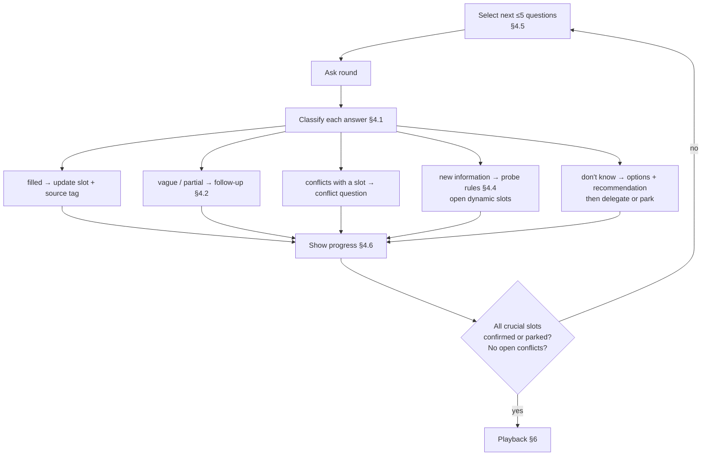

# Interview

The canonical rules for the interview (`mstack:goal`), the gap interview of `mstack:product`, and the clarify part of the requirements and design steps. Builds on `decision-policy.md`.

## 1. What the interview must achieve

The interview exists to fill the four project files (`product.md`, `tech.md`, `security.md`, `architecture.md`) **without the agent guessing anything crucial**.

It's driven by a **slot catalog**: a fixed list of facts the project files need. The interview isn't a script of questions. It's a loop that keeps asking until every crucial slot is filled.

**The interview is complete when:**

1. every crucial slot is `confirmed` (sourced `U`, `Δ`, or a user-confirmed `R`) or explicitly `parked` by the user;
2. no conflict between answers is unresolved;
3. the user has approved the playback.

Round count doesn't define completion. A greenfield product with a chatty user may need 8 rounds. A well-documented brownfield repo may need 2.

## 2. Slot catalog

Each slot has an ID, a criticality (`C` crucial, `M` minor), and a **filled-when** rule: the bar an answer must clear before the slot counts as filled. An answer that doesn't clear the bar triggers a follow-up.

### 2.1 Product slots → `product.md`

| ID | Slot | C/M | Filled when |
|---|---|---|---|
| P1 | One-sentence product purpose | C | names *who*, *what*, and *why* in one sentence |
| P2 | Primary users | C | each user type is named, with what they're trying to get done |
| P3 | Secondary actors (admins, support, staff, integrators) | C | listed, or "none" confirmed |
| P4 | Core problem and current alternative | C | the pain is stated, plus what people do today instead |
| P5 | Primary journey | C | 3–10 ordered steps from entry to value, walked through by the user |
| P6 | Success metrics | C | at least one *measurable* metric with a target and a timeframe |
| P7 | v1 in scope | C | an explicit capability list |
| P8 | Out of scope / later | C | an explicit list, or "none" confirmed |
| P9 | Platforms (web, iOS, Android, desktop, API, CLI) | C | each platform is in or out for v1 |
| P10 | Business model (free, paid, per-seat, usage…) | C | stated, or "not decided, and it doesn't affect v1" confirmed |
| P11 | Timeline and milestones | C | a target date or "none", plus any hard deadline |
| P12 | Languages / localisation | C | the v1 locales are listed |
| P13 | Accessibility target | C | a level (e.g. WCAG 2.2 AA) or "best effort" confirmed |
| P14 | Product principles and tone | M | the agent drafts them from the answers; the user sees them at playback |

### 2.2 Tech slots → `tech.md`

| ID | Slot | C/M | Filled when |
|---|---|---|---|
| T1 | Language and framework | C | chosen or confirmed from the repo, with major version |
| T2 | Hosting / cloud / runtime | C | provider and model (serverless, containers, VPS, on-prem) |
| T3 | Primary datastore | C | technology, plus managed or self-hosted |
| T4 | Authentication provider | C | built-in, or a named provider |
| T5 | Third-party services and integrations | C | each one named with its purpose, or "none" |
| T6 | Team skills and constraints | C | who maintains this, and what they know or refuse |
| T7 | Infrastructure budget | C | a monthly range |
| T8 | Environments (local, staging, prod…) | C | the list, plus how prod deploys happen |
| T9 | CI/CD | M | from the repo, or a proposal approved at playback |
| T10 | Testing expectations | C | which levels are required (unit, integration, e2e) and any coverage bar |
| T11 | Package manager, lint, format, commands | M | from the repo, or the stack's defaults (disclosed) |
| T12 | Code conventions | M | from the repo, or the stack's defaults (disclosed) |

### 2.3 Architecture slots → `architecture.md`

| ID | Slot | C/M | Filled when |
|---|---|---|---|
| A1 | Client types (SPA, SSR, mobile, CLI, public API) | C | listed |
| A2 | Deployable units (monolith, services, workers) | C | the count and the role of each |
| A3 | Background / async work | C | "none", or each job type with its trigger |
| A4 | Realtime needs | C | none, or which updates must be live and their latency |
| A5 | Data volume and growth | C | an order of magnitude for the main entities at launch and at 12 months |
| A6 | Traffic at launch and at 12 months | C | an order of magnitude (users/day, peak requests/s) |
| A7 | Availability target | C | a number (e.g. 99.5%), or "best effort" confirmed |
| A8 | Multi-tenancy | C | single-tenant, multi-tenant (with the isolation level), or N/A |
| A9 | Offline / poor-network support | C | required or not, per platform |
| A10 | Data residency | C | a region requirement, or "none" |
| A11 | Integration directions | C | inbound (webhooks, imports) and outbound (APIs, exports), each listed |
| A12 | Key architectural decisions | M | the agent records them from the A-slot answers; the user sees them at playback |

### 2.4 Security slots → `security.md`

| ID | Slot | C/M | Filled when |
|---|---|---|---|
| S1 | Data collected | C | every category is listed (PII, payment, health, location, children's data, credentials…) |
| S2 | Login methods | C | password, magic link, SSO, OAuth providers, MFA required or optional |
| S3 | Roles and permissions | C | each role with what it can and can't do |
| S4 | Compliance | C | each regime (GDPR, HIPAA, PCI, SOC2, COPPA…) in or out, with the reason |
| S5 | Retention and deletion | C | how long each data category is kept, and whether users can delete their account and data |
| S6 | Threats of concern | C | at least the top 3 actors or scenarios the user worries about |
| S7 | Admin and internal access | C | who can see production data, and how |
| S8 | Audit logging | C | which actions must be logged, or "none required" |
| S9 | AI / agent capabilities | C | "no AI", or what the model can read, write and execute |
| S10 | Secrets management | M | from the repo, or the stack's default (disclosed) |
| S11 | Breach / outage cost | C | the worst realistic consequence, in the user's own words |

### 2.5 Dynamic slots

Some answers open new slots. These are the **probe rules** (§4.4). For example, "we take payments" opens `S-PCI`, `T-PAYPROV` and `P-REFUNDS`. Dynamic slots carry the same C/M and filled-when fields.

### 2.6 Slot states

```text
unknown → asked → answered → (vague | conflict) → asked …
                          ↘ filled → confirmed (at playback)
unknown → repo-found → confirmed | corrected
asked   → parked  (user chose to defer; blocks dependent gates)
asked   → delegated → agent-proposed → confirmed
```

## 3. Interview phases

| # | Phase | Slots | Asked? |
|---|---|---|---|
| 0 | Recon | all | silent |
| 1 | Orientation | expertise, P1, P2 | always |
| 2 | Problem and outcome | P3, P4, P6, P11 | always |
| 3 | Journey and scope | P5, P7, P8, P9, P12, P13 | always |
| 4 | Constraints and business | P10, T6, T7 | always |
| 5 | Technology | T1–T12 | reduced on brownfield |
| 6 | Shape and scale | A1–A12 | always |
| 7 | Protection | S1–S11 | always |
| 8 | Conflict check | all filled | only if conflicts exist |
| 9 | Playback | all | always |

Phases run in order, because later phases build on earlier answers. A phase is skipped only when all of its crucial slots are already filled. Even then, its repo-found facts still go into the confirmation table (§5).

### Phase 0 — Recon (silent)

- Read the README, package manifests, lockfiles, Docker/compose files, IaC, CI config, `.env.example`, existing docs, any existing project files, and the top-level code structure.
- Classify the project: **greenfield** (empty or skeleton) or **brownfield** (existing product).
- Pre-fill slots from evidence as `repo-found` with `[R:<path>]`. Never mark them filled yet: the user confirms them.
- Detect conflicts inside the repo (e.g. two ORMs, README says MySQL but compose runs Postgres). These become questions.

### Phase 1 — Orientation

Opens every interview. It calibrates how the rest is asked.

1. **Expertise:** "How should I ask technical questions?"
   - (a) I'm technical, ask me directly.
   - (b) Explain the options in plain language.
   - (c) Someone else decides the technical parts, so collect those questions for them.
2. **P1:** "Describe the product in one or two sentences, as you'd explain it to a friend." This is free text, because a choice list would bias the answer.
3. **P2:** "Who uses it? List each kind of user and what they're trying to get done."

Expertise (c) puts tech and architecture questions into a hand-off list (§4.7) rather than skipping them.

### Phase 2 — Problem and outcome

- **P4:** "What do these users do today without this product? What's painful about it?"
- **P3:** "Besides [P2 users], does anyone else interact with it: admins, staff, support, partners?"
- **P6:** "Six months after launch, what number tells you it's working?" Options are derived from P1/P2 (e.g. "weekly active clinics", "bookings per week", "revenue") plus Other. A target and a timeframe are required.
- **P11:** "Is there a launch date or hard deadline?"

### Phase 3 — Journey and scope

- **P5 walkthrough:** "Walk me through the main journey, from first opening the product to getting value." The agent then plays the journey back as numbered steps and asks "Is this order right? Any step missing?"
- **P7 / P8 boundary sweep:** the agent lists the candidate capabilities it heard and asks "v1 or later?" for each one (multi-select).
- **P9:** platforms (multi-select).
- **P12 / P13:** locales and accessibility (choice).

### Phase 4 — Constraints and business

- **P10:** business model (choice + Other).
- **T6:** "Who builds and maintains this after launch? What technologies do they know, or want to avoid?"
- **T7:** monthly infrastructure budget (ranges).

### Phase 5 — Technology

On **greenfield**, the agent proposes 2–3 coherent stack options. Each option is a full bundle (framework + host + DB + auth), derived from T6, T7, P9 and A-hints, with trade-offs shown. The user picks one or mixes. Each component then becomes a confirmed slot.

On **brownfield**, phase 5 is mostly the repo confirmation table (§5), plus questions for slots the repo can't answer (T7, T10, T5 intent).

### Phase 6 — Shape and scale

Asked as **quantity** questions with order-of-magnitude ranges, so a non-technical user can answer:

- "On a busy day at launch, roughly how many people use it? <100 · 100–1k · 1k–10k · 10k+"
- "And in a year?"
- "If it's down for an hour on a weekday, what happens? Annoying · lost revenue · safety or legal problem"

The answers map to A5–A7. The agent then asks the **A2/A3/A4** shape questions with consequences explained ("Background jobs mean emails and reminders can be sent later and retried, but add a worker process to run").

### Phase 7 — Protection

- **S1:** a multi-select checklist of data categories. Each checked category triggers its probe rules.
- **S2 / S3:** login methods (choice), then a roles walkthrough: "For each user type, what can they see and change? What must they *never* see?"
- **S4:** compliance is pre-selected by probe rules (health data → HIPAA candidate, EU users → GDPR), and the user confirms or rejects each with a reason.
- **S5, S7, S8, S9, S11:** asked one by one, in that order.
- **S6:** "What would worry you most: account takeover, data leak, fraud, abuse or spam, outage, something else?" (multi-select, rank the top 3).

### Phase 8 — Conflict check

The agent cross-checks every filled slot against a set of **consistency rules** and presents each conflict as a priority question:

| Conflict rule | Example |
|---|---|
| availability vs budget | A7 = 99.99% but T7 = "<$20/month" |
| compliance vs hosting | S4 = HIPAA but T2 provider has no BAA |
| timeline vs scope | P11 = "4 weeks" but P7 lists 14 capabilities |
| offline vs realtime | A9 = offline required and A4 = live collaboration |
| team vs stack | T6 = "only knows Python" but T1 = Next.js |
| data vs retention | S1 includes children's data but S5 = "keep forever" |
| residency vs host | A10 = EU only but T2 region = us-east |

> Example: "You want 99.99% uptime (≈4 min down per month), but the budget is under $20/month, which usually buys a single server. Which gives?"
> (a) lower the target to 99.5% · (b) raise the budget · (c) Other

### Phase 9 — Playback

See §6.

## 4. The iteration engine

This is the loop that runs inside and across phases:



### 4.1 Answer classification

| Class | Detected by | Next step |
|---|---|---|
| filled | the answer meets the slot's filled-when rule | record it with `[U:I-n.m]` |
| vague | vagueness lexicon (§4.3), no number where one is required, or no example where one is required | follow-up of type *quantity* or *example* |
| partial | answers part of a compound slot (e.g. roles listed, permissions not) | follow-up for the missing part only |
| conflict | contradicts a filled slot or a repo fact | conflict question (phase 8 format), asked in the next round |
| new info | mentions a capability, actor, data type, integration or constraint not yet in the slots | probe rules; the new slots join the queue |
| don't know | "not sure", "no idea", "whatever" | decision-policy §7: options, then delegate or park |
| delegated | "you decide", "your call" | decision-policy §6: propose, then confirm |
| out of order | answers a slot from a later phase | record it; it's skipped when that phase arrives |

### 4.2 Follow-up rules

- **At most 2 follow-ups per slot.** If it's still vague after two, the agent offers concrete options and asks the user to pick one, delegate, or park.
- Follow-ups quote the user's words: "You said 'fast'. Which is closest: pages load under 1s · under 3s · it doesn't matter much?"
- A follow-up goes into the **next** round, grouped with that round's theme. It never interrupts the current round.

### 4.3 Vagueness lexicon

These words always trigger a follow-up when they're used about a crucial slot:

`fast, quick, slow, scalable, secure, safe, simple, easy, user-friendly, intuitive, robust, reliable, modern, standard, normal, best practice, industry standard, a lot, many, few, some, soon, later, cheap, affordable, enterprise, real-time (when unquantified), etc., and so on, like X`

| Vague term | Follow-up asks for |
|---|---|
| performance words | a number with a unit |
| quantity words | an order-of-magnitude range |
| quality words (secure, robust) | the specific failure the user fears |
| time words | a date or duration |
| "like X" | which *specific* aspect of X |

### 4.4 Probe rules

Each probe rule says: if an answer mentions a trigger, these slots open. Here are the starting rules. The list will live in `core/interview.md` and can grow.

| Trigger in an answer | Opens slots (questions) |
|---|---|
| payments, checkout, subscription | payment provider · PCI scope (hosted checkout or own card form) · refunds and chargebacks · currencies · tax/VAT |
| health, clinic, patient, medical | HIPAA (or local equivalent) applicability · BAA with vendors · PHI in logs/analytics · emergency-access rules |
| children, students, under-13 | COPPA/age verification · parental consent · data minimisation |
| EU / UK users | GDPR lawful basis · DPA with vendors · data export and deletion rights · cookie consent |
| mobile app | offline behaviour · push notifications · app-store review constraints · minimum OS versions |
| "teams", "organisations", "companies" | multi-tenancy · invitations · org-level roles · billing per org or per user |
| file upload, images, documents | size limits · allowed types · malware scanning · storage and retention · public or private access |
| AI, LLM, chatbot, agent | model provider · what data reaches the model · prompt-injection exposure · tool permissions · cost ceiling · human review of outputs |
| email, SMS, notifications | provider · opt-in/opt-out · quiet hours · template ownership · bounce handling |
| import, migrate, legacy | source system · data volume · cut-over plan · dual-running period |
| admin, back-office | admin roles · impersonation allowed? · audit of admin actions |
| marketplace, two-sided | both sides' journeys · payouts · disputes · trust and safety |
| public API, integrations | auth for API clients · rate limits · versioning promise · webhooks |
| realtime, live, chat | latency target · presence · message history retention · moderation |
| location, maps | precision stored · consent · retention |

The probe rules also feed the edge step later: a triggered domain predicts which edge categories will matter.

### 4.5 Next-round selection

Each round, the agent picks **≤5 questions** from the queue in this order:

1. **Unblockers first:** slots that other slots depend on (P2 before S3, because the roles need the user types).
2. **Conflicts** detected in the previous round.
3. **Follow-ups** from the previous round.
4. **The current phase's remaining crucial slots.**
5. **Dynamic slots** from probe rules, when they belong to the current phase's theme.
6. **Minor slots**, never asked individually. They're shown as proposals at playback.

A round never mixes more than two themes. If the queue for the current phase is empty, the next phase starts.

### 4.6 Progress display

After every round, the agent prints a one-line progress bar, so the user knows how much remains and why each question is being asked:

```text
Interview — Product 9/13 · Tech 2/10 · Architecture 0/11 · Security 0/10 · open conflicts 1 · parked 0
Next: 3 questions on scope boundaries, 1 conflict (timeline vs scope).
```

### 4.7 Fatigue guard and fast lane

- After every **4 rounds**, the agent offers a **fast lane**: "There are N crucial items left. I can (a) keep asking one by one, or (b) show a proposal table with a suggested answer and its basis for each, and you approve or edit rows."
- The proposal table is still a human decision. Every row is approved or edited, never defaulted silently. A row with no basis has no proposed value and must be answered directly.
- For a user who chose expertise (c), tech and architecture items are collected into a **hand-off list**. It's shown at playback and must be answered, by the user or their technical person, before the project-files approval.

### 4.8 Hard stops

- **Never more than 12 rounds.** At round 12 the agent shows the remaining items and asks: continue, use the fast lane, or park.
- An interview can **pause and resume**. The slot states are saved to `state.yaml` under `interview:`, so a new session continues at the next unanswered round.

## 5. Brownfield: repo confirmation table

Repo facts are evidence, but not decisions. The code may contain something that's being removed, or a choice nobody wants to keep. So repo-found crucial slots are confirmed **once, in a table**:

```text
I found these in the repository. Confirm or correct each:

| Slot | Found                          | Evidence                 | Keep? |
|------|--------------------------------|--------------------------|-------|
| T1   | Next.js 14 (App Router), TS    | package.json, app/       | ✅ / ✏️ |
| T3   | Postgres 15 via Prisma         | docker-compose.yml, prisma/schema.prisma | ✅ / ✏️ |
| T4   | NextAuth with Google provider  | app/api/auth/[...nextauth]/route.ts | ✅ / ✏️ |
| S3   | roles: admin, member           | prisma/schema.prisma enum Role | ✅ / ✏️ |
| ⚠    | README says MySQL, compose runs Postgres | README.md:12, docker-compose.yml | which is right? |
```

Confirmed rows become `[R:<path>]` + confirmed. Corrected rows become `[U:I-n.m]`.

## 6. Playback

Playback is the final interview phase, and its approval is required before any project file is written.

**Format:** a structured summary grouped by project file. Each line carries its source tag, so the user can see what came from them, from the repo, or from a delegation:

```markdown
## Playback — please confirm each section

### product.md
- Purpose: Online appointment booking for small dental clinics, so patients can book without calling. [U:I-1.2]
- Users: patients (book, reschedule, cancel); clinic staff (manage calendar, book for patients). [U:I-1.3, I-2.2]
- Success: 30 clinics with ≥50 bookings/week each within 6 months. [U:I-2.3]
- v1: booking, rescheduling, SMS reminders, staff calendar. Later: payments, reviews. [U:I-3.2]
- Accessibility: WCAG 2.2 AA. [U:I-3.5]
- Principles (proposed by agent): "Booking in under 60 seconds"; "Staff never double-booked". [M → approve?]

### tech.md
- Next.js 14 + TypeScript, Postgres 15 via Prisma. [R:package.json, prisma/schema.prisma — confirmed I-5.1]
- Hosting: Vercel + Neon, ≈$40/month. [Δ:I-5.3 — you delegated, I proposed, you confirmed]
…

### Parked (blocks the noted gate)
- S8 audit logging scope. Blocks the project-files approval (security.md). [?]

Confirm: (a) all correct · (b) correct with edits (tell me which lines)
```

**Rules:**

- **Per-section confirmation.** The user can approve product.md's section and correct tech.md's. Corrections re-open only the affected slots, and the next round asks only about those.
- Every `[M]` proposal (principles, conventions, A12 decisions) is shown so it can be rejected.
- A parked crucial slot is allowed through playback but **blocks the project-files approval** until it's answered, unless the user explicitly moves it to an `Open Questions` section of a file and accepts that the related features can't pass requirements approval until it's resolved.

After playback approval, `mstack:product` writes the four files. The reviewer runs the **playback diff** (decision-policy §9): the files may not contain a crucial claim absent from the approved playback.

## 7. Re-running the interview (pivot or major change)

When project files already exist, `mstack:goal` runs in **delta mode**:

1. "What changed?" (free text) → classify the affected slots.
2. Show the affected slots with their current values. The user marks each one keep, change or remove.
3. Re-run only the phases containing changed slots, then the conflict check, then a playback of **changes only**.
4. **Impact report:** list every `done` and in-progress spec whose REQs or designs depend on the changed slots (via their Decision records and source tags), so the user can decide what needs a follow-up feature or fix.

## 8. Feature-level clarification (requirements and design)

The same engine, with smaller slot catalogs, runs as the clarify part of the requirements and design steps in `mstack:feature` / `mstack:bug-fix`. These are shorter: usually 1–3 rounds.

### 8.1 Requirements slots (per feature)

| ID | Slot | Filled when |
|---|---|---|
| R1 | Actors | which P2/P3 users use this feature |
| R2 | Trigger / entry point | where and how the feature starts |
| R3 | Happy path | ordered steps, walked through by the user |
| R4 | Inputs and validation | each field: type, required, limits, format |
| R5 | Outputs and feedback | what the user sees on success |
| R6 | Permissions | who can do what, mapped to S3 roles |
| R7 | States and limits | empty states, maximums, quotas |
| R8 | Notifications | who gets told what, through which channel |
| R9 | Acceptance | how the user will judge it done |
| R10 | Baseline (bug-fix only) | which existing behaviour must not change |

### 8.2 Design slots (per feature)

Only crucial technical choices are asked, using the expertise level from phase 1:

| ID | Slot | Typical question |
|---|---|---|
| G1 | New dependency | "This needs a job queue. Use Redis (already in the stack) or add a managed queue (≈$X/month)?" |
| G2 | Public contract | the API or event shape, when other clients consume it |
| G3 | Data model semantics | what a field *means*, and uniqueness and deletion rules |
| G4 | Migration strategy | for existing data: backfill, dual-write, or cut-over |
| G5 | Rollout | feature flag, staged rollout or direct |
| G6 | Sync vs async | when it changes what the user experiences |

Internal structure (modules, helpers, file layout) is minor. It's decided by the agent, tagged `[M]`, and listed in design.md's Decision record.

## 9. Worked example (two rounds, condensed)

**Phase 0 recon:** empty repo → greenfield. No slots pre-filled.

**Round 1 (Orientation)**

> **I-1.1** How should I ask technical questions? → *(b) plain language*
> **I-1.2** Describe the product in a sentence or two. → *"An app where patients book dentist appointments online instead of calling."*
> **I-1.3** Who uses it, and what are they trying to get done? → *"Patients booking, and the clinic receptionist."*

The engine classifies the answers:

- P1 is filled.
- P2 is partial: "receptionist" is a role, but it's unclear whether dentists or clinic owners use the product too.
- A **probe rule** fires on "dentist, patients" (health): it opens the HIPAA/locale, PHI-in-logs and emergency-access slots for phase 7.
- New info: "clinic" suggests multiple clinics, which opens the multi-tenancy slot (A8) for phase 6.

Progress shown:

```text
Interview — Product 1/13 · Tech 0/10 · Architecture 0/11 · Security 0/13 (+3 health) · conflicts 0
Next: 1 follow-up on users, 4 questions on the problem and success.
```

**Round 2 (Problem and outcome)**

> **I-2.1** *(follow-up, P2)* Besides patients and receptionists, do dentists or clinic owners use it? → *"Owners see reports."*
> **I-2.2** *(P8-adjacent, multi-tenancy)* Is this for one clinic, or many clinics each with their own patients? → *(b) many clinics*
> **I-2.3** *(P4)* How do patients book today, and what's painful? → *"They call; receptionists miss calls at lunch."*
> **I-2.4** *(P6)* Six months after launch, what number tells you it's working? → *"Lots of bookings."*
> **I-2.5** *(P11)* Any launch date? → *"Soon."*

The engine classifies the answers:

- P3 is filled (owners).
- A8 is filled early (out-of-order answer), so phase 6 will skip it.
- P4 is filled.
- **P6 is vague** ("lots"), so a quantity follow-up is queued.
- **P11 is vague** ("soon"), so a date follow-up is queued.
- The probe rule for "teams/organisations" fires from "many clinics": it opens org-level roles and billing per clinic or per user.

Round 3 will open with both follow-ups:

> "You said 'lots of bookings'. Per clinic per week, which is closest: 10 · 50 · 200+?"
> "You said 'soon'. Is there a date you're aiming for, or an event (e.g. a trade show) it must be ready by?"

…and so on, until every crucial slot is confirmed, followed by the playback.
