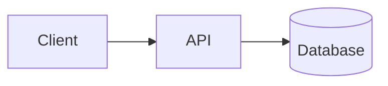

# Architecture: <Product Name>

<!-- Written by mstack:product. Slot IDs (A1…) refer to core/interview.md §2.3.
     Updated by the "update project files" sub-phase of any feature or bug-fix that changes the system's shape. Slot hints like [P1] show which interview slot fills a line. Replace each hint with the real source tag.
     -->

- Status: Draft | Reviewed | Approved
- Last updated: <date>

## Overview diagram

## Components
| Component | Kind | Responsibility | Source |
|---|---|---|---|
| <name> | <SPA, SSR app, API, worker, mobile app…> | <one line> | [A1, A2] |

## Background and realtime work
- Background jobs: <none, or each job with its trigger> [A3]
- Realtime: <none, or what must be live and how fast> [A4]

## Scale and availability
| | At launch | In 12 months | Source |
|---|---|---|---|
| Traffic | <users/day, peak req/s> | <…> | [A6] |
| Data volume | <main entities> | <…> | [A5] |

- Availability target: <e.g. 99.5%, or best effort> [A7]

## Tenancy, offline, residency
- Tenancy: <single, multi (with isolation level), N/A> [A8]
- Offline: <required or not, per platform> [A9]
- Data residency: <region requirement or none> [A10]

## Integrations
| Direction | System | How | Source |
|---|---|---|---|
| inbound | <webhooks, imports> | <…> | [A11] |
| outbound | <APIs, exports> | <…> | [A11] |

## Module layout and dependency rules
- <folder → responsibility; what may depend on what>

## Failure policies
<!-- Product-wide rules for recurring failures. Asked once in the edge-cases step of the first feature that needs them, then reused. See core/edge-cases.md §4. -->
| ID | Situation | Policy | Source |
|---|---|---|---|
| EP-01 | External service slow or down | <decision> | [U:E-…] |

## Key decisions
| Decision | Why | Source |
|---|---|---|
| <decision> | <rationale> | [A12] |

## Open questions
- <parked item and what it blocks>

## Decision record
<per core/decision-policy.md §5>
