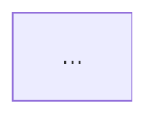
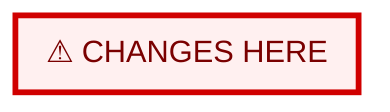

# Chart file formats

Rules are in `core/charts.md`. There are three file formats.

---

## 1. `visuals/high.md` or `visuals/low.md` — clean chart

````markdown
# <High|Low>-level chart: <Feature Name>

- Folder: spec/<slug>/
- Drawn from code at: <date> · commit <short sha>
- Key: <one line, only the shapes and lines used in this chart>



## Walkthrough
1. <①…> <one line per main step>

## Failure paths
- EDGE-00x: <condition> → <what happens>

## Trace
| Node | Traces to |
|---|---|
| <NODE_ID> | <high: REQ / AC / design § · low: `file:symbol`> |

## Unverified links
- <none, or: link — what was tried — what would confirm it>
````

---

## 2. `visuals/high.diff.md` or `visuals/low.diff.md` — bug-fix before/after

````markdown
# <High|Low>-level change: <Fix Name>

- Fixes: <feature>
- Previous chart: <path from the state.yaml charts pointer>
- Change: <1–3 lines: what changed and why, with REQ / EDGE IDs>
- Unchanged: <e.g. "the other 14 steps are unchanged">

## Chart A — Before: where the change happens



## Chart B — After: the red zone expanded

```mermaid
flowchart LR
    %% same IDs, labels and links for unchanged nodes; only the inside of CHANGE differs
    subgraph CHANGE["⚠ CHANGED: <short reason> (<IDs>)"]
        %% new content
    end
    style CHANGE fill:#fff0f0,stroke:#d00000,stroke-width:3px,color:#7a0000
    classDef added fill:#ffd6d6,stroke:#d00000,color:#1d1d1f
    classDef modified stroke:#d00000,stroke-width:2px
    classDef removed fill:#eeeeee,stroke:#888888,stroke-dasharray:4 3,color:#888888
```



## Change legend
| Node | Change | Why | Where |
|---|---|---|---|
| <NODE_ID> | added / modified / removed | <REQ / EDGE / Task> | <`file:symbol` for low-level> |

## Focus view
<!-- Only when the chart has more than 20 nodes: Chart B cropped to the red zone plus one neighbour on each side. -->
````

The clean `high.md` / `low.md` in the bug-fix folder is Chart B without the red styling and without removed nodes.

---

## 3. Chat presentation

Always print, as plain text, even when the chart is rendered elsewhere:

```text
<Header: what was built / changed, level, folder>
<Where to see it: rendered above | open <path in IDE preview> | viewer: .mstack/.cache/view-<slug>-<level>.html>
Walkthrough: …
Failure paths: …
Change legend: … (bug-fix only)
Next: ask about any box · see the other level · zoom into a step
```
