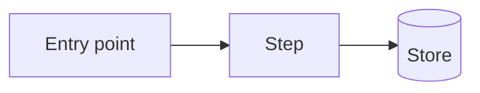

# Design: <Feature or Fix Name>

<!-- Clarify crucial technical choices (slots G1–G6, core/interview.md §8.2) with the user before writing.
     Internal structure (module names, helpers, file layout per tech.md) is minor: decide it, tag [M], list it in the Decision record.
     Use stable, semantic node IDs in diagrams (core/charts.md §4.4). They seed the charts. -->

- Status: Draft | Reviewed | Approved
- Requirements: <REQ IDs>
- Last updated: <date>

## Approach
<The smallest coherent way to meet the requirements in this repo, in a short paragraph.>

## Existing context
- <current component, pattern or constraint found in the repo> [R:path]

## Components
| Component | New / changed | Responsibility | Source |
|---|---|---|---|
| `<module or service>` | new | <one line> | [M] or [U:D-n] |

## Flow

1. <step>
2. <step>

## Contracts
| Interface | Input | Output | Errors | Source |
|---|---|---|---|---|
| `<METHOD /path>` or `<event>` | <shape> | <shape> | <codes / cases> | [U:D-n] if public |

## Data
- <entity / field changes, what each field means, uniqueness, deletion rules> [G3]
- Migration: <none, or backfill / dual-write / cut-over> [G4]

## Errors
| Situation | Behaviour |
|---|---|
| <error> | <response or recovery> |

## Security
- Authentication: <…>
- Authorization: <rule, enforced where>
- Validation: <…>
- Sensitive data: <…>
- Secrets: <…>

## Observability
- Logs: <events, no secrets or needless PII>
- Metrics / alerts: <…>

## Rollout and rollback
- Rollout: <direct, feature flag, staged> [G5]
- Rollback: <how>

## Testing
| Level | What | Covers |
|---|---|---|
| unit | <…> | REQ-001 |
| integration | <…> | AC-001.2 |
| e2e / smoke | <primary path> | REQ-001 |

## Project file impact
<!-- What this changes in the 4 project files. Anything other than "no change" becomes the final "update project files" sub-phase in tasks.md. -->
| File | Change |
|---|---|
| product.md | no change |
| tech.md | <e.g. adds Redis 7 for the job queue> |
| security.md | no change |
| architecture.md | <e.g. adds a reminder worker> |

## Not doing
- <deliberate non-goal>

## Open questions
- <parked item — blocks this gate if crucial>

## Decision record
<per core/decision-policy.md §5>
