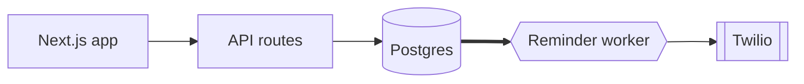

# Architecture: ClinicBook

- Status: Approved
- Last updated: 2026-10-14 (reminder worker added by spec/booking, tasks 6.3 and 7.1)

## Overview diagram

## Components
| Component | Kind | Responsibility | Source |
|---|---|---|---|
| Next.js app | SSR web app | patient booking pages and the staff calendar | [U:I-6.1] |
| API routes | serverless functions | booking logic | [U:I-6.1] |
| Reminder worker | background job (every minute) | send due SMS reminders | [U:D-02] (spec/booking) |

## Scale and availability
| | At launch | In 12 months | Source |
|---|---|---|---|
| Traffic | ~3 clinics, <500 bookings/day | ~30 clinics, <5k bookings/day | [U:I-6.2] |

- Availability target: best effort during the pilot. [U:I-6.3]

## Tenancy
- Multi-tenant. Every row carries `clinicId`, checked server-side on every query. [U:I-2.2, I-7.3]

## Failure policies
| ID | Situation | Policy | Source |
|---|---|---|---|
| EP-01 | External service slow or down | retry 3× over 1 minute, then mark failed and show it in the staff calendar | [U:E-01] (spec/booking) |
| EP-02 | Duplicate submission | deduplicate with an idempotency key | [U:E-02] (spec/booking) |

## Decision record
<abridged in this example>
