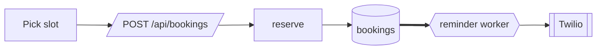

# Design: Online booking

- Status: Approved
- Requirements: REQ-001, REQ-002, REQ-003
- Last updated: 2026-10-14 (revised at the edge-cases gate: EDGE-001 unique constraint, EDGE-006 rate limit)

## Approach
A server-rendered booking page posts to one API route. A unique constraint on `(clinicId, slotStart)` makes double-booking impossible. A small worker on Railway sends due reminders every minute.

## Components
| Component | New / changed | Responsibility | Source |
|---|---|---|---|
| `app/book/[clinic]/page.tsx` | new | booking page | [M] |
| `app/api/bookings/route.ts` | new | `POST /api/bookings` | [M] |
| `src/booking/slot-service.ts` | new | reserve a slot atomically | [M] |
| `src/reminders/worker.ts` | new | every minute: send due reminders | [U:D-02] |

## Flow

## Contracts
| Interface | Input | Output | Errors | Source |
|---|---|---|---|---|
| `POST /api/bookings` | `{ clinicId, slotStart, name, phone, idempotencyKey }` | `201 { bookingId }` | `409 SLOT_TAKEN { nextSlots[3] }` · `422 INVALID_PHONE` · `429 TOO_MANY` | [M] (internal, used only by our page) |

## Data
- `Booking { id, clinicId, slotStart (UTC), name, phone, status, cancelTokenHash }`, unique `(clinicId, slotStart)` where `status = 'booked'`. [U:E-03]
- `Reminder { bookingId, dueAt (UTC), status, attempts }`.
- Migration: new tables only.

## Project file impact
| File | Change |
|---|---|
| product.md | no change |
| tech.md | adds a Railway worker process |
| security.md | no change |
| architecture.md | adds the reminder worker component; adds failure policies EP-01, EP-02 |

## Decision record

### Human decisions
| ID | Question | Answer | Source | Date |
|---|---|---|---|---|
| D-02 | Reminders need a background process. Railway worker (≈$5/month) or Vercel cron (hourly on the current plan)? | Railway worker | user | 2026-10-13 |
