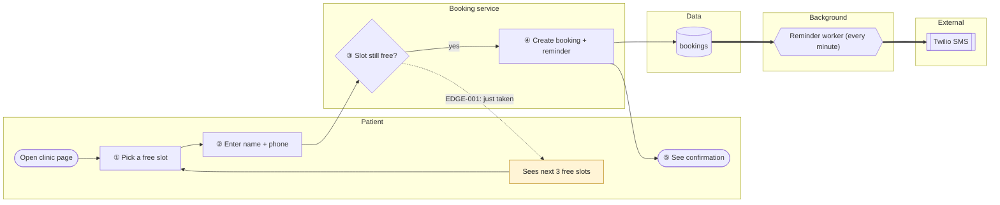

# High-level chart: Online booking

- Folder: spec/booking/
- Drawn from code at: 2026-10-16 · commit 4f2a9c1
- Key: rectangle = step · diamond = decision · cylinder = data · hexagon = background job · `[[ ]]` = external service · dotted = failure path · thick = async

## Walkthrough
1. ① The patient picks a free slot on the clinic's page.
2. ② They enter a name and a UK mobile number.
3. ③ The server checks the slot is still free. A unique constraint makes this race-safe.
4. ④ The booking and its reminder are saved.
5. ⑤ The patient sees a confirmation. 24 hours before the appointment, the worker sends the SMS reminder.

## Failure paths
- EDGE-001: the slot was taken in the meantime → the patient sees the next 3 free slots.

## Trace
| Node | Traces to |
|---|---|
| PATIENT_PICK_SLOT | AC-001.1 |
| SLOT_FREE | AC-001.4, EDGE-001 |
| CREATE_BOOKING | AC-001.2 |
| REMINDER_JOB | REQ-003, design §Components |

## Unverified links
- none
