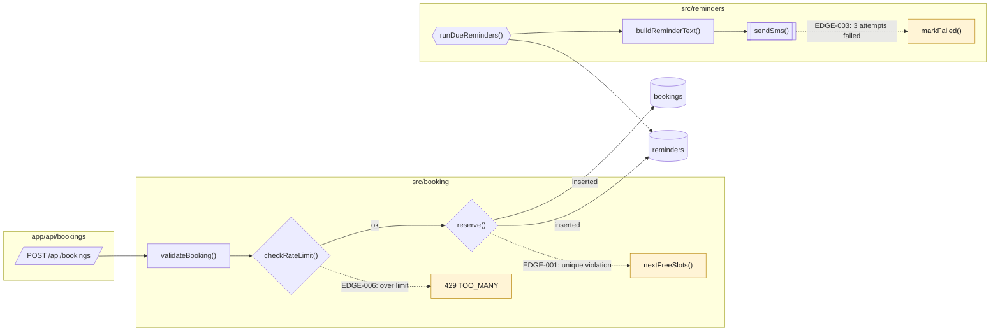

# Low-level chart: Online booking

- Folder: spec/booking/
- Drawn from code at: 2026-10-16 · commit 4f2a9c1
- Key: parallelogram = entry point · rectangle = function · diamond = branch · cylinder = table · hexagon = job · `[[ ]]` = external call · dotted = failure path

## Walkthrough
1. `ROUTE__POST_BOOKINGS` validates the body (`BOOKING__VALIDATE`) and checks the rate limits (`RATE_LIMIT__CHECK`).
2. `SLOT_SERVICE__RESERVE` inserts the booking and its reminder in one transaction.
3. Every minute, `REMINDER_WORKER__RUN_DUE` loads due reminders, builds the text and calls Twilio.

## Failure paths
- EDGE-006: over the limit → 429.
- EDGE-001: unique violation → `nextFreeSlots()` → 409 with 3 alternatives.
- EDGE-003: Twilio fails 3 times → `markFailed()`, shown in the staff calendar.

## Trace
| Node | `file:symbol` |
|---|---|
| ROUTE__POST_BOOKINGS | `app/api/bookings/route.ts:POST` |
| BOOKING__VALIDATE | `src/booking/validate.ts:validateBooking` |
| RATE_LIMIT__CHECK | `src/booking/rate-limit.ts:checkRateLimit` |
| SLOT_SERVICE__RESERVE | `src/booking/slot-service.ts:reserve` |
| SLOT_SERVICE__NEXT_FREE | `src/booking/slot-service.ts:nextFreeSlots` |
| RESP__TOO_MANY | `app/api/bookings/route.ts:POST` (429 branch) |
| REMINDER_WORKER__RUN_DUE | `src/reminders/worker.ts:runDueReminders` |
| REMINDER__BUILD_TEXT | `src/reminders/message.ts:buildReminderText` |
| TWILIO__SEND_SMS | `src/reminders/twilio.ts:sendSms` |
| REMINDER__MARK_FAILED | `src/reminders/worker.ts:markFailed` |
| DB__BOOKINGS / DB__REMINDERS | `prisma/schema.prisma:Booking / Reminder` |

## Unverified links
- none
