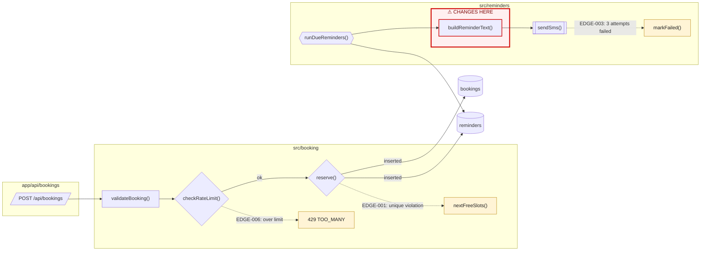
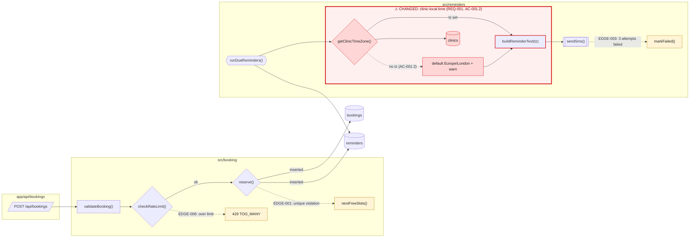

# Low-level change: Reminder shows the wrong time

- Fixes: booking
- Previous chart: spec/booking/visuals/low.md
- Change: the reminder text is now formatted in the clinic's time zone, which is read from the clinic record (REQ-001, AC-001.2).
- Unchanged: the booking path and the retry/failure handling (11 of the 12 existing nodes are unchanged).

## Chart A — Before: where the change happens

## Chart B — After: the red zone expanded

## Change legend
| Node | Change | Why | Where |
|---|---|---|---|
| CLINIC__GET_TIMEZONE | added | REQ-001, Task 1.1.1 | `src/clinics/timezone.ts:getClinicTimeZone` |
| CLINIC__DEFAULT_TZ | added | AC-001.2, Task 1.1.2 | `src/clinics/timezone.ts:getClinicTimeZone` (fallback branch) |
| DB__CLINICS | added (newly read) | REQ-001 | `prisma/schema.prisma:Clinic.timeZone` |
| REMINDER__BUILD_TEXT | modified: now takes `tz` and uses `Intl.DateTimeFormat` with `timeZone` | AC-001.1, Task 1.2.1 | `src/reminders/message.ts:buildReminderText` |
