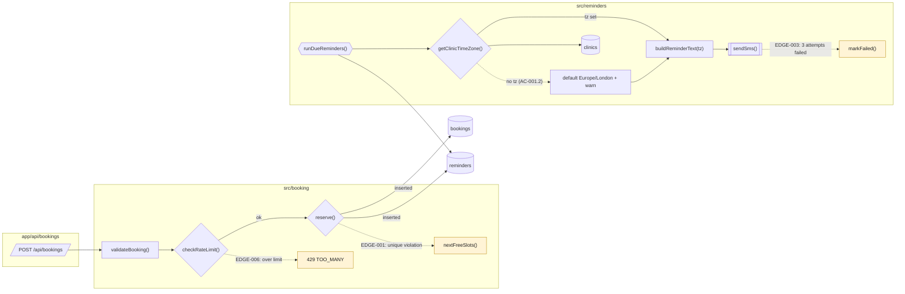

# Low-level chart: Online booking (after fix-reminder-timezone)

- Folder: spec/fix-reminder-timezone/
- Drawn from code at: 2026-10-22 · commit 9b31e07
- Key: parallelogram = entry point · rectangle = function · diamond = branch · cylinder = table · hexagon = job · `[[ ]]` = external call · dotted = failure path

## Walkthrough
1. The booking path is unchanged (see spec/booking/visuals/low.md).
2. `REMINDER_WORKER__RUN_DUE` now gets the clinic's time zone (`CLINIC__GET_TIMEZONE`) before building the text, and falls back to Europe/London with a warning.

## Failure paths
- AC-001.2: no clinic time zone → default Europe/London + warning.
- EDGE-001, EDGE-003, EDGE-006: unchanged.

## Trace
See spec/booking/visuals/low.md for the unchanged nodes. New and changed nodes are in low.diff.md → Change legend.

## Unverified links
- none
